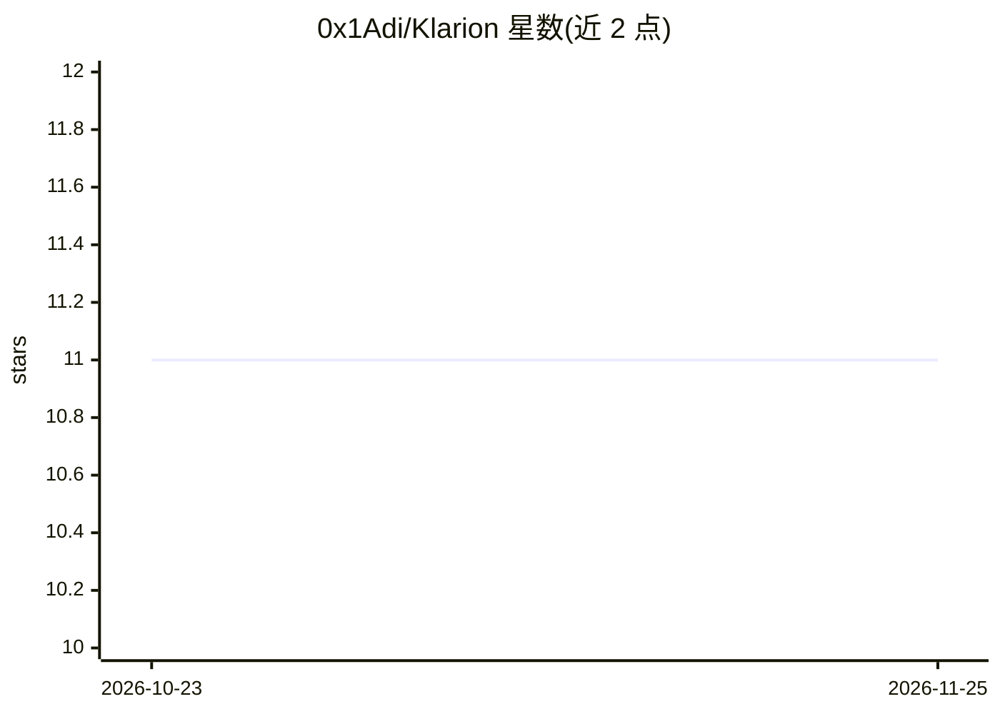

# 0x1Adi/Klarion

⭐ 11 · Go · MIT · 推送 2026-10-03 · [GitHub](https://github.com/0x1Adi/Klarion) · [官网](https://klargate.com/klarion) · 个人维护

**AI 辅助的代码与 git 历史密钥泄漏扫描器**

两步机制检测代码中的泄漏密钥：第一步本地快速检查（已知密钥格式、password 赋值行、凭据文件、base64/hex、随机度）筛出候选；第二步由 AI 模型结合上下文逐条判定真伪，降低误报。运行形态包括 CLI、pre-commit 钩子、GitHub Action、MCP server 与 Claude Code hook，支持 baseline 只对新增密钥告警。需配置一个 AI 模型方可运行，无模型时 scan 与钩子报错退出；输出为检测结果，不修复密钥。

## 筛选速览

| 维度 | 判定 | 备注 |
|---|---|---|
| AI 角色 | `ai-native` | 本体是模型或模型工具 |
| 许可风险 | `permissive` | MIT |
| 部署形态 | `desktop` | 安装包/桌面程序 |
| 模型依赖 | local-ok | 支持本地模型 |
| 硬件要求 | — | 无带数字的原话,不猜 |
| 安装摩擦 | `low` | 无编译、无系统依赖或容器化 |
| 成熟度 | — | 结构信号不足 |

## 能力要点

- Rényi 熵本地检测 + LLM 逐条裁决的两步流水线
- 五种运行形态：CLI / pre-commit / GitHub Action / MCP server / Claude Code hook
- 支持 Anthropic、OpenAI 兼容接口、本地 Ollama 与 Claude Code 登录四种模型来源
- send_secret = false 可只发送脱敏值；--show-suppressed 查看被隐藏的判定

## 适用场景

- 提交前拦截新增的 API key 与凭据
- 在 Claude Code/Cline/Cursor 等 agent 写码时阻止写入密钥
- CI 中对 PR 增量内容做密钥扫描
- 对已有发现的老仓库用 baseline 只查新增泄漏

## 场景标签

`网络安全` `代码审查` · 领域:编码与开发

## 证据(README 行号)

> L1: Klarion finds leaked secrets in code. An AI model checks each one, so you see the real ones.
> L13: 1. **Find.** Fast local checks flag anything that looks like a secret.
> L14: 2. **Check.** An AI model reads each one with the code around it and decides if it is real.

## 星数曲线

2026-10-23 11 → 2026-11-25 11（+0）

---
*卡片 v1 · prompt 1.4 · 生成 2026-11-19 · 置信度 high · 依据 README sha `1505f25ba9da` · [字段定义](../../DATASET.md)*
