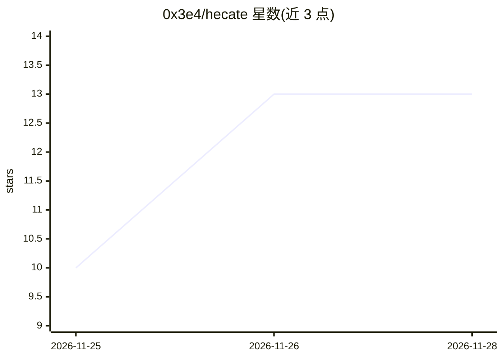

# 0x3e4/hecate

⭐ 13 · Python · MIT · 推送 2026-11-27 · [GitHub](https://github.com/0x3e4/hecate) · [官网](https://hecate.pw) · 个人维护

**自托管漏洞管理平台：聚合 9 个 CVE 源并提供 SCA 扫描与 SBOM/VEX**

自托管的漏洞管理服务：从 EUVD、NVD、CISA KEV、GHSA、OSV、CIRCL、CPE、CWE、CAPEC 等 9 个数据源摄取通告，归一化为统一 schema，经 REST API 与 React 前端提供检索（含 DQL、受影响版本范围查询）与统计。附带硬化容器化的扫描 sidecar，对镜像和源码仓库运行 Trivy、Grype、Syft、Semgrep 等 11 个扫描器，覆盖 SCA、SBOM/VEX、供应链恶意包检测、攻击路径图与 ATT&CK 链。核心功能无需 AI 与 API key 即可运行；AI 分析默认关闭，仅追加叙述与分诊文本，可接本地模型或云端模型。通过 Docker Compose 部署，内置 46 工具的 MCP 服务器与 Apprise 通知。README 自述为年轻的个人项目。

## 筛选速览

| 维度 | 判定 | 备注 |
|---|---|---|
| AI 角色 | `ai-enhanced` | 去掉 AI 部分产品仍成立 |
| 许可风险 | `permissive` | MIT |
| 部署形态 | `self-host` | docker 或自建部署 |
| 模型依赖 | local-ok | 支持本地模型 |
| 硬件要求 | — | 无带数字的原话,不猜 |
| 安装摩擦 | `low` | 无编译、无系统依赖或容器化 |
| 成熟度 | `idea` | |

## 能力要点

- 聚合 9 个漏洞数据源并归一化为单一 VulnerabilityDocument schema
- 11 个扫描器组成的 sidecar 覆盖镜像与源码仓库的 SCA 扫描
- 供应链恶意包检测：35 条启发式规则加 OSV MAL-* 持续监控
- AI 分析默认关闭，支持本地模型（Ollama/vLLM/LM Studio）与云端模型

## 适用场景

- 自托管企业漏洞库，聚合 NVD/KEV/GHSA 等源并按资产清单匹配告警
- 对容器镜像和代码仓库做 SCA 扫描并生成 SBOM/VEX
- 在 CI 安装依赖前通过 REST/MCP 接口查询包的阻断/警告判定

## 场景标签

`网络安全` · 领域:学习与行业

## 证据(README 行号)

> L5: > Self-hosted vulnerability management – aggregate, search and act on advisories, scan your images and repos. AI opt
> L12: > **Works without AI.** Every core feature runs without an API key: the catalogue and its search, SCA scanning, SBO

## 星数曲线

2026-11-25 10 → 2026-11-28 13（+3）

---
*卡片 v1 · prompt 1.4 · 生成 2026-11-24 · 置信度 mid · 依据 README sha `82f5abc6bb98` · [字段定义](../../DATASET.md)*
