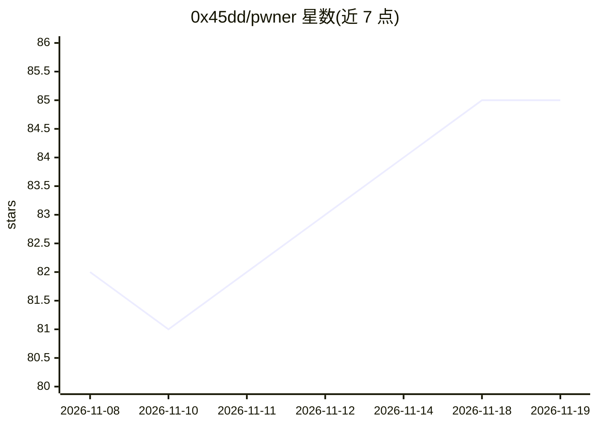

# 0x45dd/pwner

⭐ 85 · Python · AGPL-3.0 · 推送 2026-11-05 · [GitHub](https://github.com/0x45dd/pwner) · [官网](https://www.pwner.si) · 个人维护

**给安全测试者：用对话驱动的自主网络渗透测试代理**

运行于终端的 LLM 驱动渗透测试代理：以自然语言下达指令，自动规划并执行主机发现、服务指纹识别、已知问题核查，经人工批准后可执行利用以证明影响。驱动 nmap、nuclei、netexec、hydra 等 52 个真实工具的封装。安全机制在代码层实现：范围锁在每次工具调用前校验目标，暴力破解/远程执行等侵入性操作默认拒绝需会话内批准。支持 OpenAI/Anthropic/Google/DeepSeek 及 Ollama、llama.cpp 等本地端点，也可用 --no-ai 无模型确定性运行。明确限定用于授权测试场景。

## 筛选速览

| 维度 | 判定 | 备注 |
|---|---|---|
| AI 角色 | `ai-native` | 本体是模型或模型工具 |
| 许可风险 | `viral` | AGPL-3.0 |
| 部署形态 | `self-host` | docker 或自建部署 |
| 模型依赖 | local-ok | 支持本地模型 |
| 硬件要求 | — | 无带数字的原话,不猜 |
| 安装摩擦 | `low` | 无编译、无系统依赖或容器化 |
| 成熟度 | — | 结构信号不足 |

## 能力要点

- 自然语言对话驱动，可中途重定向的代理循环
- 范围锁与同意门在代码层实现，位于模型权限之外
- 52 个工具封装（nmap/nuclei/netexec/impacket/hydra 等）
- 支持本地模型端点（Ollama/lemonade/llama.cpp/vLLM），或 --no-ai 无模型运行

## 适用场景

- 在授权范围内执行网络渗透测试并生成带证据的报告
- CTF 或自有实验环境中用自然语言指挥扫描与分析
- 无需 API key 在本地模型上离线运行侦察流水线

## 场景标签

`网络安全` · 领域:学习与行业

## 证据(README 行号)

> L36: `pwner` is an LLM-driven agent that plans and runs a network penetration test from your
> L39: real tools (nmap, nuclei, netexec, impacket, hydra and others) rather than simulating them,

## 星数曲线

2026-11-08 82 → 2026-11-19 85（+3）

---
*卡片 v1 · prompt 1.4 · 生成 2026-11-18 · 置信度 high · 依据 README sha `55f6e570ad00` · [字段定义](../../DATASET.md)*
