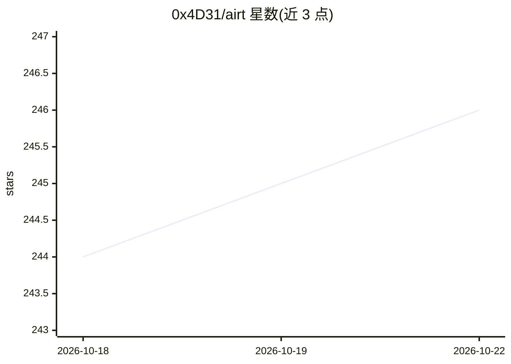

# 0x4D31/airt

⭐ 246 · HTML · 推送 2026-03-07 · [GitHub](https://github.com/0x4D31/airt) · [官网](https://0x4d31.github.io/airt/) · 个人维护

**免费开源的 AI 红队测试课程：8 模块 60+ 小时含 Docker 实验**

面向 AI 安全学习者的免费开源课程，覆盖 AI 系统攻击性安全测试：提示注入、RAG 与向量数据库攻击、多智能体利用、供应链攻击、模型提取等 8 个模块，共 60+ 小时内容。每个模块附带 Docker 实验环境，全部通过 Ollama 本地运行，无需云 API key。环境要求 Docker、8GB+ 内存（16GB 推荐）与约 20GB 磁盘。内容由 Perplexity Computer 辅助构建，内容按 CC BY-SA 4.0、代码按 MIT 许可。

## 筛选速览

| 维度 | 判定 | 备注 |
|---|---|---|
| AI 角色 | `ai-knowledge` | 知识聚合/清单类 |
| 许可风险 | `none` | — |
| 部署形态 | `self-host` | docker 或自建部署 |
| 模型依赖 | local-ok | 支持本地模型 |
| 硬件要求 | — | 无带数字的原话,不猜 |
| 安装摩擦 | `low` | 无编译、无系统依赖或容器化 |
| 成熟度 | — | 结构信号不足 |

## 能力要点

- 8 个模块覆盖 MITRE ATLAS、OWASP LLM Top 10 等主题
- 60+ 小时内容，每模块含 Docker 动手实验
- 实验全部本地运行（Ollama），无需云 API key
- 内容 CC BY-SA 4.0、代码 MIT 双许可

## 适用场景

- 系统学习 AI 系统的红队测试方法
- 在本地 Docker 环境动手练习提示注入与 RAG 攻击
- 了解 garak、PyRIT 等自动化红队工具及 CI/CD 集成

## 场景标签

`教程课程` `网络安全` · 领域:学习与行业

## 证据(README 行号)

> L3: A free, open-source course covering offensive security testing of AI systems — from prompt injection to supply chain
> L11: |1|Foundations of AI Red Teaming|MITRE ATLAS, OWASP LLM Top 10, threat modeling|
> L22: Each module includes a Docker-based lab environment. No cloud API keys needed — everything runs locally via Ollama.

## 星数曲线

2026-10-18 244 → 2026-10-22 246（+2）

---
*卡片 v1 · prompt 1.4 · 生成 2026-10-22 · 置信度 high · 依据 README sha `efd7e4111ef2` · [字段定义](../../DATASET.md)*
