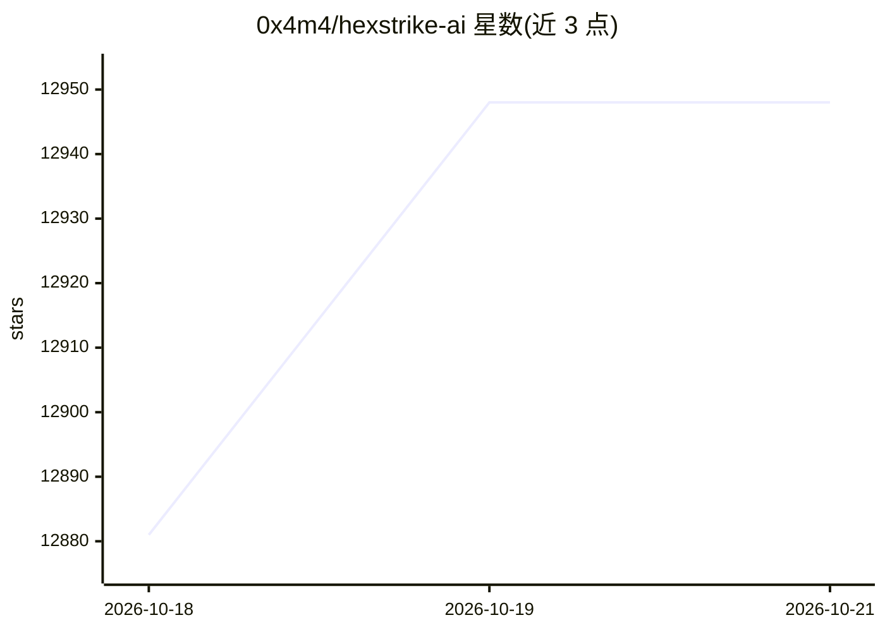

# 0x4m4/hexstrike-ai

⭐ 12,948 · Python · MIT · 推送 2026-08-03 · [GitHub](https://github.com/0x4m4/hexstrike-ai) · [官网](https://www.hexstrike.com/) · 组织维护

**供 AI agent 自动调用 150+ 渗透测试工具的 MCP 服务器**

由 OTT Cybersecurity LLC 开发的 Python 语言 MCP 服务器：通过 FastMCP 协议让 Claude、GPT、Copilot 等 MCP 兼容 agent 接入，自动执行 150+ 安全工具（网络侦察、Web 漏洞扫描、密码破解、二进制分析、云与容器安全等），包含 12+ 自主 AI agent、决策引擎、无头 Chrome 浏览器 agent 与报告输出。安装方式为 git clone 源码运行 hexstrike_server.py，需自行安装 nmap、nuclei 等外部安全工具；提供 Claude Desktop、Cursor、VS Code Copilot 等客户端接入配置说明。

## 筛选速览

| 维度 | 判定 | 备注 |
|---|---|---|
| AI 角色 | `ai-ecosystem` | LLM/agent 周边工具 |
| 许可风险 | `permissive` | MIT |
| 部署形态 | `None` |  |
| 模型依赖 | — | README 未给出锁定关系 |
| 硬件要求 | — | 无带数字的原话,不猜 |
| 安装摩擦 | `medium` | 含编译或系统依赖之一 |
| 成熟度 | — | 结构信号不足 |

## 能力要点

- 150+ 安全工具覆盖侦察、Web 测试、密码、二进制、云安全等类别
- FastMCP 协议接入 Claude/GPT/Copilot 等 MCP 兼容 agent
- 12+ 自主 AI agent 与决策引擎选择测试策略
- Selenium 无头 Chrome 浏览器 agent（DOM 分析、流量监控、截图）

## 适用场景

- 渗透测试人员通过 AI 对话驱动自动化安全评估
- 漏洞挖掘与 bug bounty 的工具编排自动化
- CTF 与安全研究中的工具批量调用

## 场景标签

`网络安全` · 领域:学习与行业

## 证据(README 行号)

> L15: **Advanced AI-powered penetration testing MCP framework with 150+ security tools and 12+ autonomous AI agents**
> L44: 1. **AI Agent Connection** - Claude, GPT, or other MCP-compatible agents connect via FastMCP protocol

## 星数曲线

2026-10-18 12,881 → 2026-10-21 12,948（+67）

---
*卡片 v1 · prompt 1.4 · 生成 2026-10-20 · 置信度 high · 依据 README sha `453c5c57db61` · [字段定义](../../DATASET.md)*
