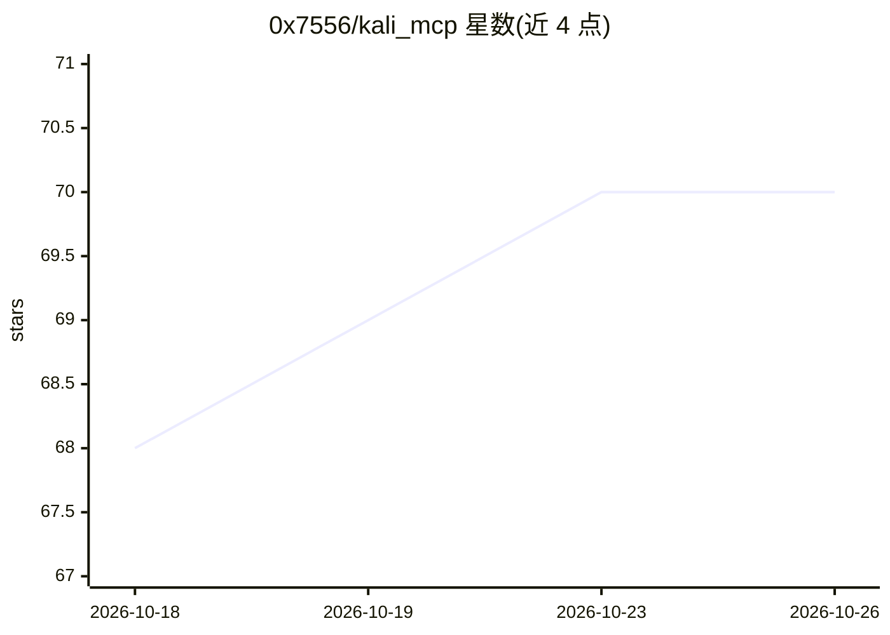

# 0x7556/kali_mcp

⭐ 70 · 推送 2026-06-07 · [GitHub](https://github.com/0x7556/kali_mcp) · [官网](http://www.18k.icu) · 个人维护 · 中文 README

**让 AI 通过自然语言驱动 Kali 渗透测试工具的 MCP 工具集**

面向渗透测试人员的 MCP 服务器：将 sqlmap、Nmap、subfinder、Nikto、Metasploit、Aircrack-ng、John the Ripper、OpenVAS、Gobuster、theHarvester 等十余种 Kali 常用安全工具封装为 AI 可调用的工具，用户通过自然语言对话即可执行安全命令、检测 SQL 注入、扫描端口、发现子域名等。内置危险命令黑名单（禁止关机/重启/全盘删除）。以 MCP 配置方式接入 AI 客户端，声明支持 Kali/Ubuntu/Windows/Linux/MacOS。仅供授权环境下的教育与研究用途。

## 筛选速览

| 维度 | 判定 | 备注 |
|---|---|---|
| AI 角色 | `ai-ecosystem` | LLM/agent 周边工具 |
| 许可风险 | `none` | — |
| 部署形态 | `None` |  |
| 模型依赖 | — | README 未给出锁定关系 |
| 硬件要求 | — | 无带数字的原话,不猜 |
| 安装摩擦 | `low` | 无编译、无系统依赖或容器化 |
| 成熟度 | — | 结构信号不足 |

## 能力要点

- 封装 sqlmap/Nmap/Metasploit/OpenVAS 等十余种渗透测试工具为 MCP 工具
- 自然语言驱动命令执行，含危险命令黑名单防护
- 支持自动化扫描、报告生成与批量处理

## 适用场景

- 在授权测试环境中用自然语言让 AI 执行渗透测试流程
- 让 AI 自动化完成端口扫描、子域名发现、漏洞扫描等信息收集工作
- 通过对话让 AI 编写并迭代测试脚本

## 场景标签

`网络安全` · 领域:学习与行业

## 证据(README 行号)

> L5: Kali MCP是一个AI渗透工具，旨在简化渗透测试过程。用户可以通过自然语言操作 AI 执行各种安全测试。
> L30:   "mcpServers": {

## 星数曲线

2026-10-18 68 → 2026-10-26 70（+2）

---
*卡片 v1 · prompt 1.4 · 生成 2026-10-24 · 置信度 high · 依据 README sha `6ee39de772be` · [字段定义](../../DATASET.md)*
