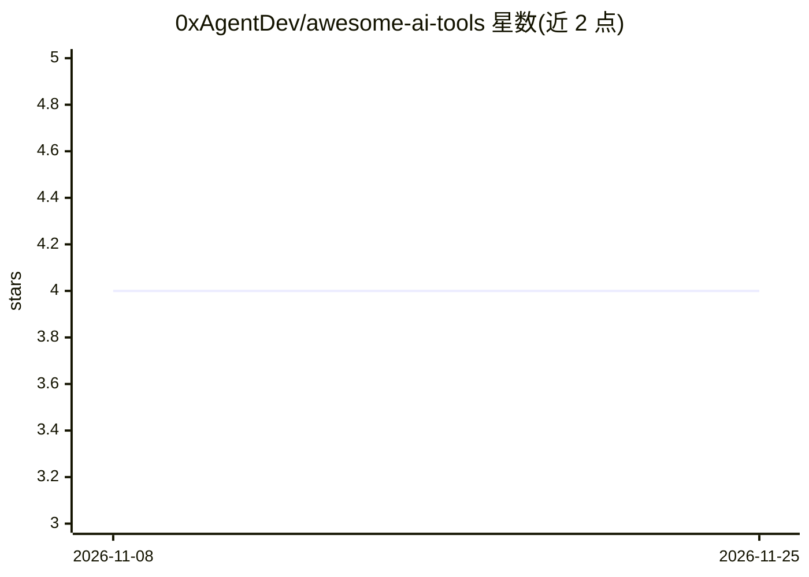

# 0xAgentDev/awesome-ai-tools

⭐ 4 · Python · CC0-1.0 · 推送 2026-11-06 · [GitHub](https://github.com/0xAgentDev/awesome-ai-tools) · 个人维护

**AI 工具精选清单：编码代理、本地 LLM、RAG、评测等**

一份按类别组织的 AI 工具聚合清单，覆盖编码代理、AI 代码编辑器、Agent 框架、本地 LLM 运行、RAG、向量数据库、Agent 记忆、评测与可观测性、MCP、语音、图像视频、工作流自动化与网络抓取等十余个分类，每条为外部工具的链接与简介。README 声明由 CI 检查每条链接的有效性，失效或过时条目通过 PR 维护。清单面向需要查找和选择 AI 工具的开发者。

## 筛选速览

| 维度 | 判定 | 备注 |
|---|---|---|
| AI 角色 | `ai-knowledge` | 知识聚合/清单类 |
| 许可风险 | `viral` | CC0-1.0 |
| 部署形态 | `library` | 以包/库形式分发 |
| 模型依赖 | — | README 未给出锁定关系 |
| 硬件要求 | — | 无带数字的原话,不猜 |
| 安装摩擦 | `low` | 无编译、无系统依赖或容器化 |
| 成熟度 | — | 结构信号不足 |

## 能力要点

- 按十余个分类组织 AI 工具条目
- CI 检查每条链接有效性，通过 PR 维护更新
- 覆盖编码代理、RAG、评测、MCP、语音、视频等类目

## 适用场景

- 查找某类 AI 工具的候选清单
- 为本地运行开源模型挑选推理运行时
- 为 agent 项目选型框架、记忆层与评测工具

## 场景标签

`精选清单` · 领域:学习与行业

## 证据(README 行号)

> L1: # Awesome AI Tools
> L3: A curated list of AI tools worth your time. Coding agents, local LLMs, RAG,
> L8: ## Contents

## 星数曲线

2026-11-08 4 → 2026-11-25 4（+0）

---
*卡片 v1 · prompt 1.4 · 生成 2026-11-21 · 置信度 mid · 依据 README sha `6ed3ff98d5e6` · [字段定义](../../DATASET.md)*
