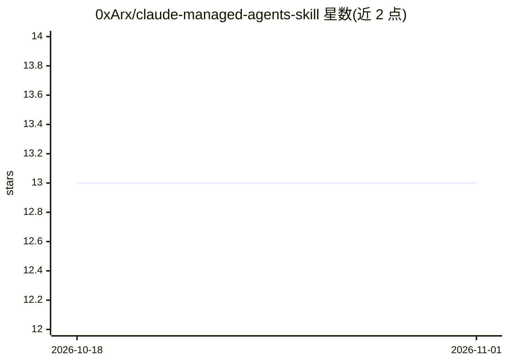

# 0xArx/claude-managed-agents-skill

⭐ 13 · 推送 2026-04-09 · [GitHub](https://github.com/0xArx/claude-managed-agents-skill) · 个人维护

**Claude Code 技能包：为 Claude 提供 Managed Agents API 开发知识**

面向 Claude Code 的技能（skill）包：以 SKILL.md 与 references/ 目录形式提供 Anthropic Claude Managed Agents API 的开发知识，覆盖事件循环、事件类型、工具权限、MCP 两步认证、Vault 凭据管理、容器规格、会话管理与生产模式（调试、静默失败、成本监控）等。基于 progressive disclosure 机制按需加载上下文。要求 Claude Code 与可访问 managed-agents-2026-04-01 beta 的 ANTHROPIC_API_KEY；自称是文档配套而非 agent 或 SDK。通过 git clone / curl 一键脚本安装到 ~/.claude/skills/。

## 筛选速览

| 维度 | 判定 | 备注 |
|---|---|---|
| AI 角色 | `ai-knowledge` | 知识聚合/清单类 |
| 许可风险 | `none` | — |
| 部署形态 | `None` |  |
| 模型依赖 | locked-api |  |
| 硬件要求 | — | 无带数字的原话,不猜 |
| 安装摩擦 | `low` | 无编译、无系统依赖或容器化 |
| 成熟度 | `idea` | |

## 能力要点

- 以 SKILL.md + 7 个 references 文件组织 Managed Agents API 开发知识
- progressive disclosure：名称/描述常驻上下文，触发时才加载全文
- 收录事件流顺序、stop_reason、MCP 认证拆分等非显性开发模式
- 针对 managed-agents-2026-04-01 beta 版本构建

## 适用场景

- 在 Claude Code 中开发 Managed Agents 应用时自动获得 API 上下文
- 排查事件循环、自定义工具挂起、版本锁定等常见问题
- 构建带 MCP 连接器与 Vault 凭据的 agent

## 场景标签

 · 领域:AI 开发者工具/知识

## 证据(README 行号)

> L5: A Claude Code skill that gives Claude deep, always-available knowledge of the **Claude Managed Agents API** — Anthro
> L115: This is a **Claude Code skill** — documentation that helps Claude write code using the Managed Agents API. It is n

## 星数曲线

2026-10-18 13 → 2026-11-01 13（+0）

---
*卡片 v1 · prompt 1.4 · 生成 2026-10-31 · 置信度 high · 依据 README sha `a6f48912740f` · [字段定义](../../DATASET.md)*
