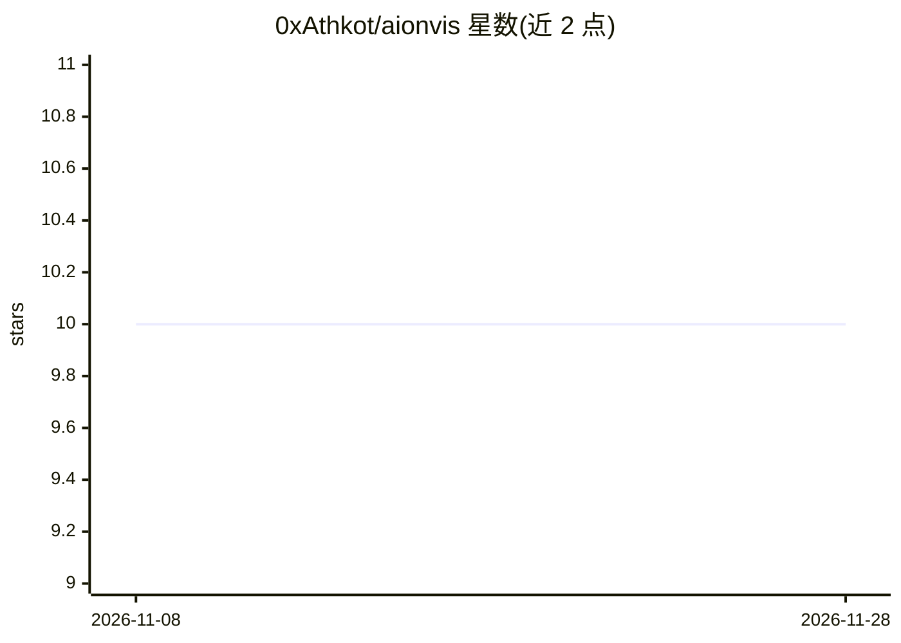

# 0xAthkot/aionvis

⭐ 10 · TypeScript · MIT · 推送 2026-10-29 · [GitHub](https://github.com/0xAthkot/aionvis) · [官网](https://aionvis.com) · 个人维护

**一句话生成合成数据并训练出目标检测模型，零人工标注**

aionVIS 是一个面向计算机视觉的自治 agent 集群：用户输入一句用途描述，五个 agent（Prompt/Synthesis/Vision/Critic/MLOps）依次完成场景设计、图像合成、自动标注、标签自校验和 YOLO/RT-DETR/RF-DETR 训练，输出可部署的检测模型。LLM（Gemma 4）与全部模型经 vLLM/diffusers/PyTorch 自托管于单张 AMD MI300X（192 GB，ROCm），不调用第三方 AI API。SAM 3 权重在 Hugging Face 上受 gating；无 vLLM 时降级为确定性模板路径。提供托管控制台、本地 Next.js 控制台与 Docker CPU 参考栈三种运行方式。

## 筛选速览

| 维度 | 判定 | 备注 |
|---|---|---|
| AI 角色 | `ai-native` | 本体是模型或模型工具 |
| 许可风险 | `permissive` | MIT |
| 部署形态 | `self-host` | docker 或自建部署 |
| 模型依赖 | local-ok | 支持本地模型 |
| 硬件要求 | — | 无带数字的原话,不猜 |
| 安装摩擦 | `low` | 无编译、无系统依赖或容器化 |
| 成熟度 | — | 结构信号不足 |

## 能力要点

- 五 agent 流水线：合成→标注→自校验→训练，全程零人工标签
- 全部模型驻留单张 MI300X 的 192 GB 显存，合成/视觉/校验三路并行流式重叠
- Critic 结合几何自检与 Gemma 4 VLM 抽检，22,718 个标签接受、42,214 个拒绝
- 控制台支持浏览器内 mock 模式（MSW），无 GPU 即可体验全部界面

## 适用场景

- 不想人工标注，用一句话生成检测数据集并训练模型
- 在 AMD Developer Cloud 上跑通 ROCm 全栈视觉训练流水线
- 用浏览器模拟模式先行试用，再把控制台接到自己的 GPU 节点

## 场景标签

`目标检测` `MLOps` `图像生成` · 领域:内容生成

## 证据(README 行号)

> L26: aionVIS is an autonomous agent swarm for **computer vision**. It generates its
> L28: **object-detection** models. Tested on AMD hardware.
> L49: |**Prompt**|Gemma 4 26B-A4B MoE|vLLM on MI300X|

## 星数曲线

2026-11-08 10 → 2026-11-28 10（+0）

---
*卡片 v1 · prompt 1.4 · 生成 2026-11-20 · 置信度 high · 依据 README sha `8029c3f4af14` · [字段定义](../../DATASET.md)*
