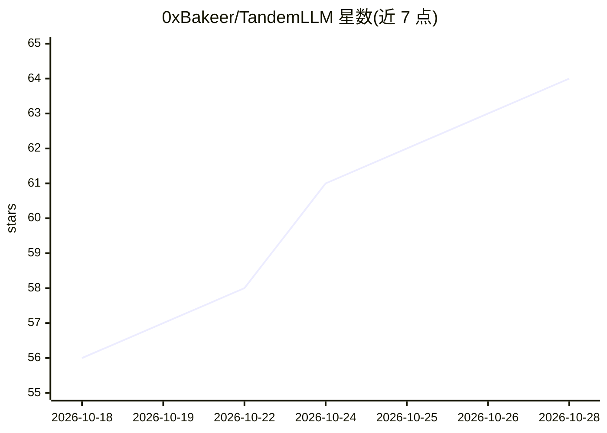

# 0xBakeer/TandemLLM

⭐ 65 · Python · AGPL-3.0 · 推送 2026-10-27 · [GitHub](https://github.com/0xBakeer/TandemLLM) · [官网](https://tandemllm.0xbakeer.com) · 个人维护

**单台 NVIDIA DGX Spark 上的本地推理引擎：自起草自验证的投机解码**

面向单台 NVIDIA DGX Spark 的自托管 LLM 推理引擎，采用小起草器猜测 token、大模型批量验证的投机解码机制，保证输出为模型自身贪心文本（有文档化例外）。支持 Qwen3.8-27B、Qwen3.8-Flash-Next、LFM2.5-24B-A2B、Nemotron 3.5 Bolt/Super VL、Ornith-1.5-122B、Flint 等模型，提供 NVFP4/EXL3/GGUF 多档量化 profile，含 KL 与 top-1 精度对照及实测速度表。通过 install.sh 与 use-profile.sh 脚本安装，自动下载权重并校验 sha256，引擎服务于 8000 端口；限制是每次只运行一个模型，且部分模型的视觉塔未提供服务。

## 筛选速览

| 维度 | 判定 | 备注 |
|---|---|---|
| AI 角色 | `ai-ecosystem` | LLM/agent 周边工具 |
| 许可风险 | `dual` | AGPL-3.0 |
| 部署形态 | `self-host` | docker 或自建部署 |
| 模型依赖 | — | README 未给出锁定关系 |
| 硬件要求 | — | 无带数字的原话,不猜 |
| 安装摩擦 | `low` | 无编译、无系统依赖或容器化 |
| 成熟度 | — | 结构信号不足 |

## 能力要点

- 起草-验证式投机解码，输出保持模型自身贪心文本
- 支持 Qwen3.8 / LFM2.5 / Nemotron 3.5 / Ornith / Flint 等多系列模型
- NVFP4 / EXL3 多档量化 profile，附 KL 与 top-1 精度数据
- 脚本化安装：自动下载权重并按 sha256 校验

## 适用场景

- 在 DGX Spark 上自托管运行多种开源大模型
- 需要高解码速度且输出与贪心解码一致的场景
- 比较不同量化档位的精度与速度取舍

## 场景标签

`推理引擎` · 领域:训练与推理

## 证据(README 行号)

> L27: TandemLLM is an inference engine for one NVIDIA DGX Spark, and it runs several models: Qwen3.8-27B, Qwen3.8-Flash-N
> L31: TandemLLM is a working name, and it says how the engine works. Small drafters guess the next tokens, and the big mo

## 星数曲线

2026-10-18 56 → 2026-10-28 64（+8）

---
*卡片 v1 · prompt 1.4 · 生成 2026-10-24 · 置信度 mid · 依据 README sha `101cc50b8869` · [字段定义](../../DATASET.md)*
