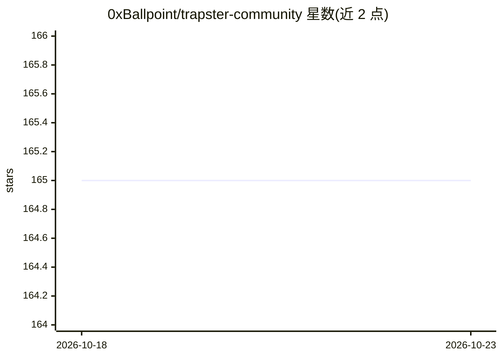

# 0xBallpoint/trapster-community

⭐ 165 · Python · AGPL-3.0 · 推送 2026-10-18 · [GitHub](https://github.com/0xBallpoint/trapster-community) · [官网](https://docs.trapster.cloud/community/) · 组织维护

**部署在内网的多协议低交互蜜罐，含 AI 应答生成**

低交互蜜罐，部署在内网或用于捕获凭据：支持 FTP/SSH/Telnet/DNS/HTTP(S)/SNMP/LDAP/Rsync/MSSQL/MySQL/RDP/PostgreSQL/VNC 等 14 种协议，记录连接、数据、登录与查询四类事件，日志支持 default JSON 与 ECS 格式，输出到终端/文件/API/Redis。HTTP 引擎可用 YAML 配置克隆任意网站并以模板或 AI 模型生成响应；SSH 可生成伪造 shell 应答。AI 通过 AI_BASE_URL/AI_MODEL/AI_API_KEY 环境变量接入 OpenAI 兼容 API（默认 o4-mini），README 附免责声明：AI 应答可被指纹识别，面向 CTI 研究而非生产防御。有商业版本另售。

## 筛选速览

| 维度 | 判定 | 备注 |
|---|---|---|
| AI 角色 | `ai-enhanced` | 去掉 AI 部分产品仍成立 |
| 许可风险 | `viral` | AGPL-3.0 |
| 部署形态 | `self-host` | docker 或自建部署 |
| 模型依赖 | — | README 未给出锁定关系 |
| 硬件要求 | — | 无带数字的原话,不猜 |
| 安装摩擦 | `low` | 无编译、无系统依赖或容器化 |
| 成熟度 | — | 结构信号不足 |

## 能力要点

- 14 种协议的登录/查询捕获（FTP/SSH/LDAP/RDP/数据库等）
- HTTP 引擎按 YAML+正则克隆任意网站，支持 Jinja2 模板、ETag、HTTP/2
- AI 生成 HTTP/SSH 应答，兼容 OpenAI API（默认 o4-mini），可按 IP+用户名持久化会话
- 日志支持 ECS 格式与终端/文件/API/Redis 四种输出

## 适用场景

- 在内网部署蜜罐捕获攻击者凭据与探测行为
- 克隆内部系统登录页诱导并记录登录尝试
- 为 CTI 研究观察攻击者对 AI 驱动后端的工具与行为

## 场景标签

`网络安全` · 领域:学习与行业

## 证据(README 行号)

> L8: Trapster Community is a low-interaction honeypot designed to be deployed on internal networks or to capture credenti
> L18: - **HTTP Honeypot Engine with AI capabilities**: Clone any website using YAML configuration, and use AI to generate
> L236: > **Disclaimer:** AI-generated responses are not a substitute for intrusion detection. A

## 星数曲线

2026-10-18 165 → 2026-10-23 165（+0）

---
*卡片 v1 · prompt 1.4 · 生成 2026-10-22 · 置信度 high · 依据 README sha `93f5a0cd196f` · [字段定义](../../DATASET.md)*
