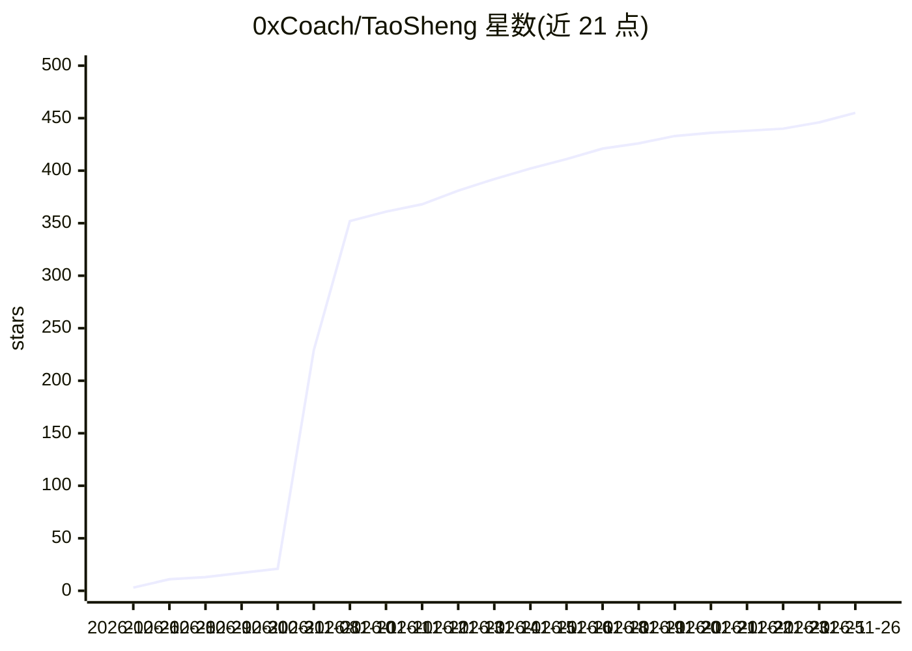

# 0xCoach/TaoSheng

⭐ 455 · Kotlin · NOASSERTION · 推送 2026-11-25 · [GitHub](https://github.com/0xCoach/TaoSheng) · 个人维护 · 中文 README

**安卓用户的24小时全场景语音记录与AI整理应用**

一款安卓 App：用手机麦克风或蓝牙设备全天收音，本地或云端转写，本机声纹区分说话人，再交给大模型整理成待办、事件与记忆，支持问答反查原话出处。核心机制包括 Silero VAD 只录人声、SenseVoice 离线识别（骁龙 NPU 加速）、多服务商主备容灾。数据留在本机，无需账号与官方服务器。分发方式为 GitHub/魔搭下载 APK，也可从源码编译（需 JDK 21）。

## 筛选速览

| 维度 | 判定 | 备注 |
|---|---|---|
| AI 角色 | `ai-native` | 本体是模型或模型工具 |
| 许可风险 | `none` | NOASSERTION |
| 部署形态 | `None` |  |
| 模型依赖 | locked-api |  |
| 硬件要求 | — | 无带数字的原话,不猜 |
| 安装摩擦 | `high` | 编译与系统依赖俱全 |
| 成熟度 | — | 结构信号不足 |

## 能力要点

- 全天收音+离线转写+本机声纹认人，数据不出手机
- 夜间睡眠记录：鼾声、咳嗽、梦话识别与声音地图
- 内置 DeepSeek、豆包、通义等十多家服务商，支持任意 OpenAI 兼容接口与局域网自建模型
- 记忆以 Markdown+JSON 增量推送到 10 种通道，可交给 Claude Code 等智能体读取

## 适用场景

- 会议、培训、访谈自动出纪要并提取待办
- 手机放床头记录鼾声梦话并生成给医生的摘要页
- 随时打字问'上周答应了谁什么'，答案附原话出处
- 把每日记忆推送给自己的 AI Agent 再加工

## 场景标签

`知识库管理` `语音识别` `AI 助手` · 领域:对话与助手

## 证据(README 行号)

> L7: 一部安卓手机就够：全天收音 → 自动转写 → 认出谁在说 → AI 整理成待办、约定和记忆。
> L63: - 可选 SenseVoice 本地完全离线识别，骁龙 NPU 加速
> L188:  🧠 AI 整理成一件件事 说过的话自动变成事件、待办、约定、决定和灵感，按时间排好，关键信息一眼看到。

## 星数曲线

2026-10-26 3 → 2026-11-26 455（+452）

---
*卡片 v1 · prompt 1.4 · 生成 2026-11-26 · 置信度 high · 依据 README sha `d71563e64207` · [字段定义](../../DATASET.md)*
