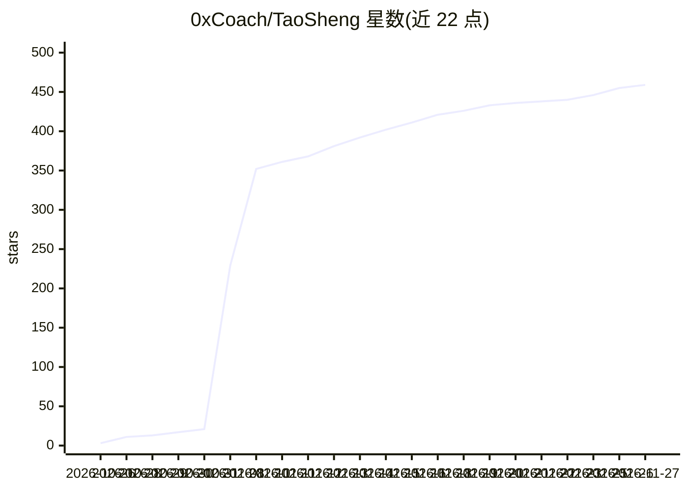

# 0xCoach/TaoSheng

⭐ 459 · Kotlin · NOASSERTION · 推送 2026-11-26 · [GitHub](https://github.com/0xCoach/TaoSheng) · 个人维护 · 中文 README

**安卓全天收音 lifelog 应用：转写认人后 AI 整理成待办与记忆**

基于 Kotlin/Jetpack Compose 的 Android 应用：手机后台收音（支持蓝牙耳机、领夹麦、通话录音及 Omi/ADeus/D3200 等专用设备），Silero VAD 只录人声，可选 SenseVoice 本地离线转写（骁龙 NPU 加速）或豆包等云端转写，本机声纹区分说话人，再交给大模型整理成事件、待办、约定与记忆，支持问答反查原话出处。无需账号与官方服务器，数据留存本机，备份到 WebDAV/S3，记忆可增量推送给 Claude Code 等 Agent。

## 筛选速览

| 维度 | 判定 | 备注 |
|---|---|---|
| AI 角色 | `ai-native` | 本体是模型或模型工具 |
| 许可风险 | `none` | NOASSERTION |
| 部署形态 | `None` |  |
| 模型依赖 | locked-api |  |
| 硬件要求 | — | 无带数字的原话,不猜 |
| 安装摩擦 | `high` | 编译与系统依赖俱全 |
| 成熟度 | `idea` | |

## 能力要点

- 24 小时收音：白天对话、夜间鼾声与梦话、9 类环境音本机识别
- SenseVoice 本地离线转写 + CAM++ 声纹认人，可完全本地运行
- AI 整理待办/纪要/回顾，问答答案附原话出处
- 记忆 Markdown+JSON 增量推送到 10 种通道，可接 Obsidian

## 适用场景

- 记录每天说过的话、答应的事，自动变成待办
- 床头放手机，记录睡眠、鼾声和梦话
- 会议/培训/通话录音自动出纪要
- 把个人记忆推送给自己的 AI Agent 只读使用

## 场景标签

`知识库管理` `语音识别` · 领域:知识与检索

## 证据(README 行号)

> L7: 一部安卓手机就够：全天收音 → 自动转写 → 认出谁在说 → AI 整理成待办、约定和记忆。
> L38: **涛声的思路很简单：手机本来就随身，麦克风本来就在。** 让它安安静静地在后台听，有人说话才录；隔一阵子统一转成文字，认出是谁说的，再交给大模型整理成一件件事。你需要时，打字问一句就能找回来，答案附着原话出处。
> L131: - 内置 DeepSeek、豆包、通义、Kimi、智谱等十多家服务商，可查余额、低额提醒

## 星数曲线

2026-10-26 3 → 2026-11-27 459（+456）

---
*卡片 v1 · prompt 1.4 · 生成 2026-11-27 · 置信度 high · 依据 README sha `8520c67b804c` · [字段定义](../../DATASET.md)*
