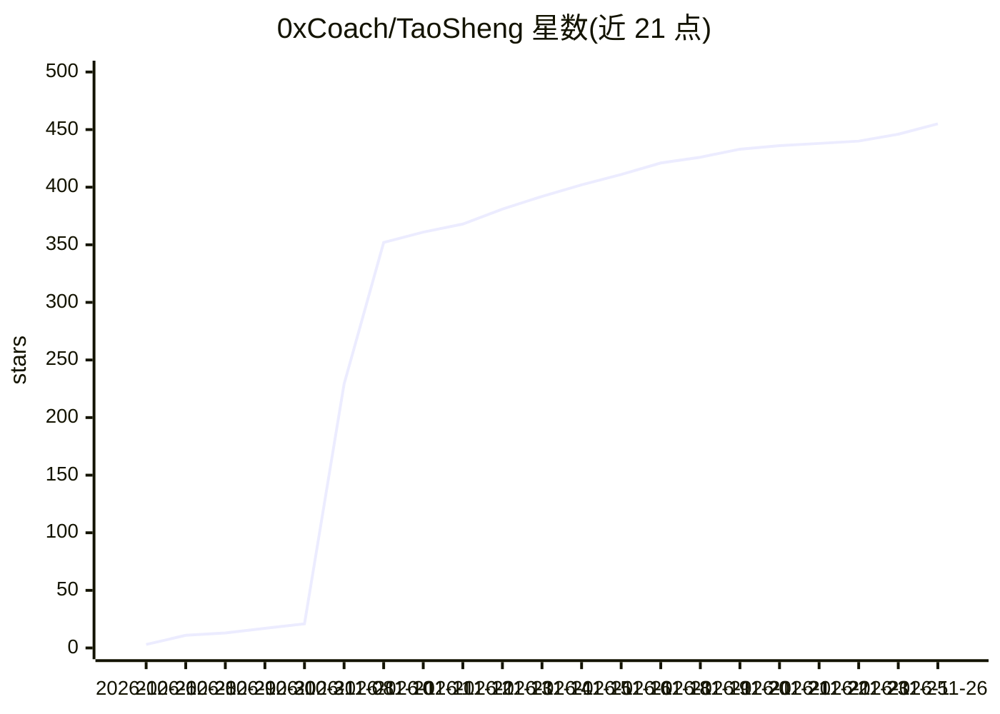

# 0xCoach/TaoSheng

⭐ 455 · Kotlin · NOASSERTION · 推送 2026-11-25 · [GitHub](https://github.com/0xCoach/TaoSheng) · 个人维护 · 中文 README

**用安卓手机全天收音并 AI 整理成待办与记忆的 lifelog 应用**

面向个人用户的安卓 lifelog 应用：手机后台全天收音，按 Silero VAD 只录人声，本机声纹区分说话人，通过本地 SenseVoice 或云端转写服务转文字，再交给大模型整理成事件、待办、约定与记忆，提问答案附原话出处。支持夜间睡眠记录、环境音识别、足迹与屏幕时间等线索。数据留在本机，无需注册账号；模型可配任意 OpenAI 兼容接口，支持主备容灾。安装方式为 APK 下载，源码编译需 JDK 21 与 Android SDK 36。

## 筛选速览

| 维度 | 判定 | 备注 |
|---|---|---|
| AI 角色 | `ai-native` | 本体是模型或模型工具 |
| 许可风险 | `none` | NOASSERTION |
| 部署形态 | `None` |  |
| 模型依赖 | locked-api |  |
| 硬件要求 | — | 无带数字的原话,不猜 |
| 安装摩擦 | `high` | 编译与系统依赖俱全 |
| 成熟度 | `idea` | |

## 能力要点

- 离线转写（SenseVoice + 骁龙 NPU）与本机声纹认人可选
- 自动生成待办、每日/每周回顾，问问功能答案附原话
- 记忆可推送到 10 种通道并复制给 Claude Code 等 Agent
- 无官方服务器，密钥存系统安全区，原录音默认 3 天自动删

## 适用场景

- 开会答应的事自动变待办，防止遗忘
- 把日常对话整理成可搜索的个人记忆库
- 夜间自动记录睡眠、鼾声与梦话
- 把每天的记忆增量推送给自己的 AI Agent 再加工

## 场景标签

`知识库管理` `语音识别` · 领域:知识与检索

## 证据(README 行号)

> L7: 一部安卓手机就够：全天收音 → 自动转写 → 认出谁在说 → AI 整理成待办、约定和记忆。
> L38: **涛声的思路很简单：手机本来就随身，麦克风本来就在。** 让它安安静静地在后台听，有人说话才录；隔一阵子统一转成文字，认出是谁说的，再交给大模型整理成一件件事。你需要时，打字问一句就能找回来，答案附着原话出处。
> L38: **涛声的思路很简单：手机本来就随身，麦克风本来就在。** 让它安安静静地在后台听，有人说话才录；隔一阵子统一转成文字，认出是谁说的，再交给大模型整理成一件件事。你需要时，打字问一句就能找回来，答案附着原话出处。

## 星数曲线

2026-10-26 3 → 2026-11-26 455（+452）

---
*卡片 v1 · prompt 1.4 · 生成 2026-11-25 · 置信度 high · 依据 README sha `9e1f8da2bdf7` · [字段定义](../../DATASET.md)*
