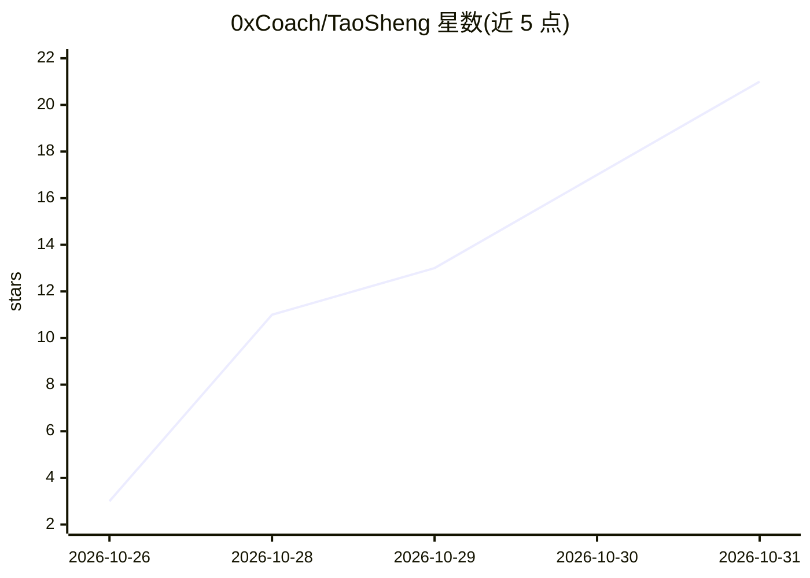

# 0xCoach/TaoSheng

⭐ 21 · Kotlin · NOASSERTION · 推送 2026-10-30 · [GitHub](https://github.com/0xCoach/TaoSheng) · 个人维护 · 中文 README

**安卓全天录音转写认人并整理成待办与记忆的个人应用**

面向个人用户的安卓 App：手机麦克风或蓝牙设备全天收音，Silero VAD 本机检测人声后按间隔自动转写（可选 SenseVoice 本地离线转写/骁龙 NPU 加速，或豆包云端），本机声纹（CAM++）区分说话人，再由大模型（任意 OpenAI 兼容接口，默认 DeepSeek）整理成待办、约定、事件与记忆，支持打字问答并附原话出处。不注册账号，数据存本机，可增量备份到坚果云，结果推送到 10 种通道。当前为早期验证版，主要在小米 14 Pro 实测。

## 筛选速览

| 维度 | 判定 | 备注 |
|---|---|---|
| AI 角色 | `ai-native` | 本体是模型或模型工具 |
| 许可风险 | `permissive` | NOASSERTION |
| 部署形态 | `None` |  |
| 模型依赖 | locked-api |  |
| 硬件要求 | — | 无带数字的原话,不猜 |
| 安装摩擦 | `medium` | 含编译或系统依赖之一 |
| 成熟度 | `idea` | |

## 能力要点

- 全天收音 + 本机 VAD 只录人声，实测耗电约 0.5%/小时
- SenseVoice 本地离线转写（骁龙 NPU 加速）或豆包云端可选
- 本机声纹认人，多人会议自动分段，长按指定一次即记住声音
- 任意 OpenAI 兼容接口整理，可全程本地运行；问答答案附原话出处

## 适用场景

- 用一部旧安卓手机替代 AI 录音吊坠，全天记录并整理我说过的话
- 开会答应的事、约好的时间自动变成待办并提醒
- 打字问一句找回某天说过的话，答案能点回原话
- 每天自动生成回顾并推送到 Notion/飞书/Telegram 等通道

## 场景标签

`语音识别` `知识库管理` · 领域:知识与检索

## 证据(README 行号)

> L7: 一部安卓手机就够：全天收音 → 自动转写 → 认出谁在说 → AI 整理成待办、约定和记忆。
> L51: 2. **📴 本地模型完全离线转写**：可选 SenseVoice 本地识别（骁龙 NPU 加速），声音不出手机、不花一分钱；也可用豆包云端或自定义转写服务。
> L188: |云端|豆包语音流式识别 2.0 · DeepSeek / 任意 OpenAI 兼容接口|

## 星数曲线

2026-10-26 3 → 2026-10-31 21（+18）

---
*卡片 v1 · prompt 1.4 · 生成 2026-10-30 · 置信度 high · 依据 README sha `559b125a72b9` · [字段定义](../../DATASET.md)*
