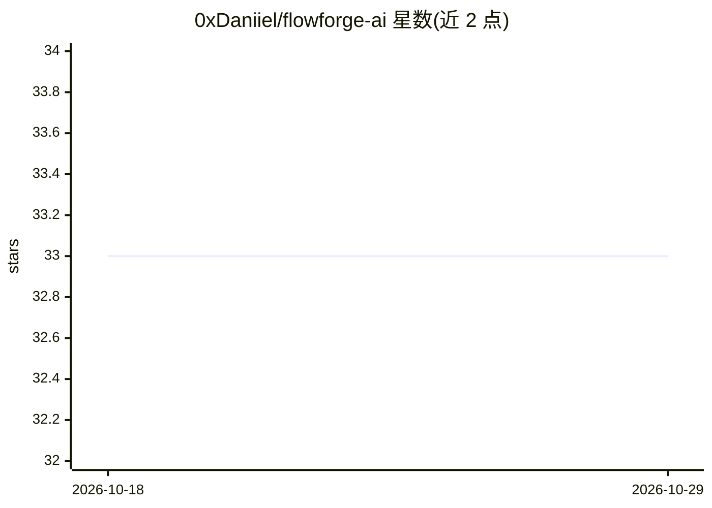

# 0xDaniiel/flowforge-ai

⭐ 33 · TypeScript · NOASSERTION · 推送 2026-02-04 · [GitHub](https://github.com/0xDaniiel/flowforge-ai) · 个人维护

**可视化 AI 工作流搭建器：拖拽节点连线并实时模拟**

基于 Next.js、React Flow、Zustand 与 TailwindCSS 构建的 Web 应用：在画布上点击添加工作流节点，通过拖拽节点手柄连接步骤，并实时预览 AI agent 的执行过程，用于发现流程问题或优化步骤。状态管理由 Zustand 提供，支持自定义节点组件、主题与字体配置。README 未给出安装或运行命令，也未说明是否接入实际模型后端；面向希望以拖拽方式原型化 AI 工作流的开发者、数据科学家与 AI 爱好者。

## 筛选速览

| 维度 | 判定 | 备注 |
|---|---|---|
| AI 角色 | `ai-ecosystem` | LLM/agent 周边工具 |
| 许可风险 | `none` | NOASSERTION |
| 部署形态 | `None` |  |
| 模型依赖 | — | README 未给出锁定关系 |
| 硬件要求 | — | 无带数字的原话,不猜 |
| 安装摩擦 | `low` | 无编译、无系统依赖或容器化 |
| 成熟度 | — | 结构信号不足 |

## 能力要点

- 拖拽式节点编辑器，点击画布添加节点、拖拽手柄连线
- 实时模拟 AI agent 工作流执行并可视化
- Zustand 状态管理，可修改工作流逻辑与模拟行为
- 支持自定义 React Flow 节点组件与 TailwindCSS 主题

## 适用场景

- 以可视化方式梳理复杂 AI 流程的概念与步骤
- 不写代码原型化并模拟 AI agent 工作流
- 通过模拟执行发现流程问题并调整步骤

## 场景标签

`工作流自动化` · 领域:效率与自动化

## 证据(README 行号)

> L3: **Visual AI Workflow Builder** using Next.js, React Flow, Zustand & Tailwind. Drag-and-drop nodes, connect steps, an
> L8: - **Real-time Simulation:** Test and visualize AI agent execution instantly.

## 星数曲线

2026-10-18 33 → 2026-10-29 33（+0）

---
*卡片 v1 · prompt 1.4 · 生成 2026-10-25 · 置信度 mid · 依据 README sha `e6e7e287766d` · [字段定义](../../DATASET.md)*
