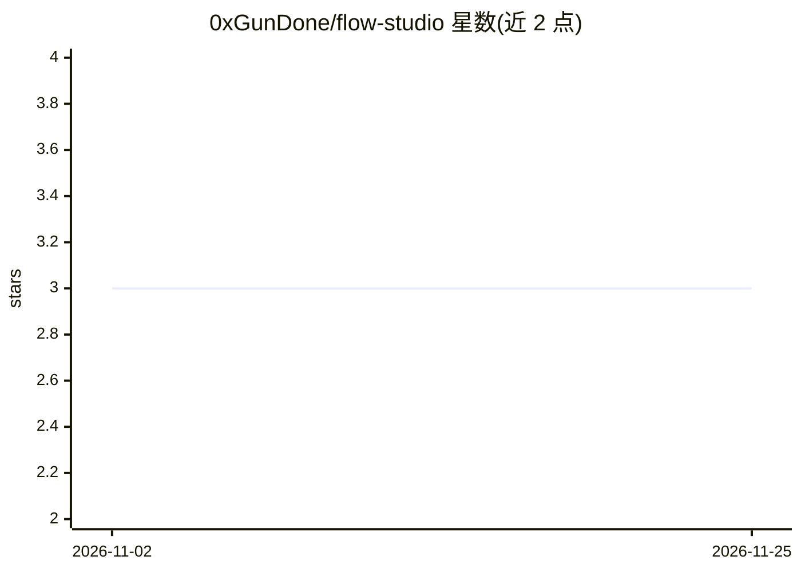

# 0xGunDone/flow-studio

⭐ 3 · Python · MIT · 推送 2026-11-19 · [GitHub](https://github.com/0xGunDone/flow-studio) · [官网](https://github.com/0xGunDone/flow-studio#readme) · 个人维护

**macOS 本地 Google Flow 图像与视频生成桌面客户端**

将 Google Flow 封装为独立的 macOS Electron 应用：文本生成图像与视频、图像编辑、最多五张参考图、Frames/Ingredients 模式、多 Google 账户会话管理、历史记录与结果导出。支持 Nano Banana、Omni 1.2 Flash、Veo 3.1 等模型的后台浏览器生成，生成通过内置 Flow2API 本地引擎（首次启动时在 Docker 容器中构建）。提供 MCP 适配器（3 类 API、24 个工具），使外部 agent 可操作同一应用。生成在 Google 侧执行，可能消耗 Flow 信用。

## 筛选速览

| 维度 | 判定 | 备注 |
|---|---|---|
| AI 角色 | `ai-native` | 本体是模型或模型工具 |
| 许可风险 | `permissive` | MIT |
| 部署形态 | `self-host` | docker 或自建部署 |
| 模型依赖 | — | README 未给出锁定关系 |
| 硬件要求 | — | 无带数字的原话,不猜 |
| 安装摩擦 | `low` | 无编译、无系统依赖或容器化 |
| 成熟度 | `idea` | |

## 能力要点

- 多 Google 账户会话管理，独立 Chrome 配 profile 登录
- MCP 接口提供 24 个工具，供 agent 调用目录、生成、文件、账户与诊断
- 后台浏览器生成无需屏幕录制或辅助功能权限
- 本地历史、关键帧管理、结果保存与重复任务恢复

## 适用场景

- 在 Mac 桌面端管理多个 Google 账户生成图像与视频
- 让外部 AI agent 通过 MCP 自动执行生成任务并保存文件
- 本地整理生成历史、参考图与关键帧素材

## 场景标签

`图像生成` `视频生成` · 领域:内容生成

## 证据(README 行号)

> L3:  Google Flow в отдельном приложении для macOS.
> L4:  Изображения, видео, аккаунты и история — в одном окне. Те же возможности доступны агентам через MCP.
> L26: |MCP|API 3, 24 инструментов для каталога, подготовки, генерации, файлов, аккаунтов и диагностики|

## 星数曲线

2026-11-02 3 → 2026-11-25 3（+0）

---
*卡片 v1 · prompt 1.4 · 生成 2026-11-22 · 置信度 mid · 依据 README sha `c2d20b0960b0` · [字段定义](../../DATASET.md)*
