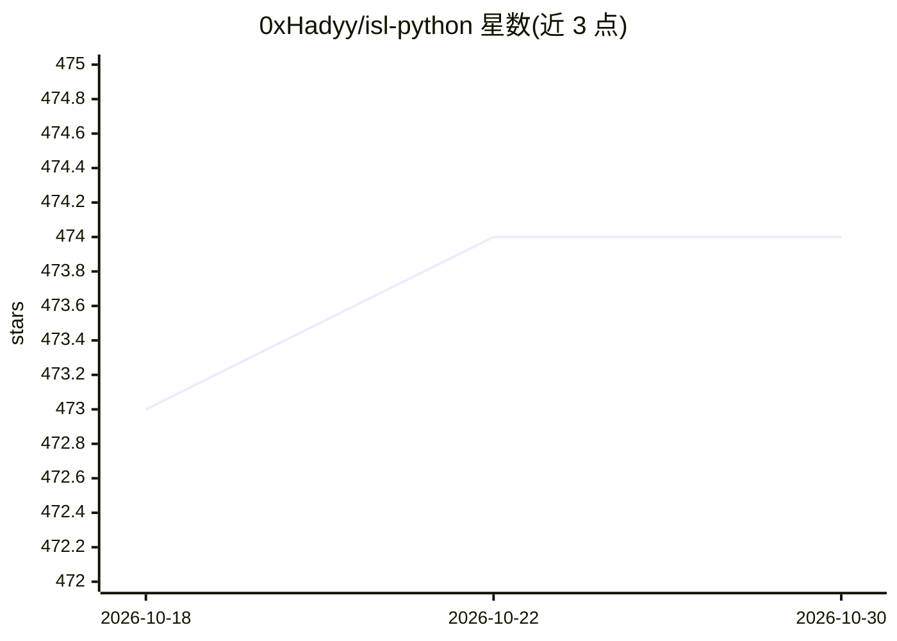

# 0xHadyy/isl-python

⭐ 474 · Jupyter Notebook · 推送 2026-02-14 · [GitHub](https://github.com/0xHadyy/isl-python) · 个人维护

**个人学习笔记库：《统计学习导论》Python 实现与进度记录**

记录作者学习《An Introduction to Statistical Learning》教材及 ESL 进阶内容的过程，以 Python 实现书中理论，包含代码、习题与笔记。README 以路线图形式展示各章学习进度：已完成第 1-7 章（引言、统计学习、线性回归、分类、重采样、正则化、非线性方法），第 8-13 章（树方法、SVM、深度学习、生存分析、无监督学习、多重检验）列为待学。另列出教材免费 PDF、补充数学资料与作者 YouTube 学习视频链接。

## 筛选速览

| 维度 | 判定 | 备注 |
|---|---|---|
| AI 角色 | `ai-knowledge` | 知识聚合/清单类 |
| 许可风险 | `none` | — |
| 部署形态 | `None` |  |
| 模型依赖 | — | README 未给出锁定关系 |
| 硬件要求 | — | 无带数字的原话,不猜 |
| 安装摩擦 | `low` | 无编译、无系统依赖或容器化 |
| 成熟度 | — | 结构信号不足 |

## 能力要点

- 按章节记录 ISL 教材学习进度与完成日期
- 以 Python 实现书中理论并附代码与习题
- 包含第 8-13 章后续学习计划
- 附教材免费 PDF 与数学补充资料链接

## 适用场景

- 跟随他人学习路径自学统计学习教材
- 查找 ISL 各章的 Python 实现参考
- 对照进度安排自己的学习计划

## 场景标签

`教程课程` · 领域:学习与行业

## 证据(README 行号)

> L3: This repository documents my personal learning journey studying "An Introduction to Statistical Learning" (ISL) + Ad
> L5: ## 🧭 Roadmap

## 星数曲线

2026-10-18 473 → 2026-10-30 474（+1）

---
*卡片 v1 · prompt 1.4 · 生成 2026-10-21 · 置信度 high · 依据 README sha `2f822c0cd0de` · [字段定义](../../DATASET.md)*
