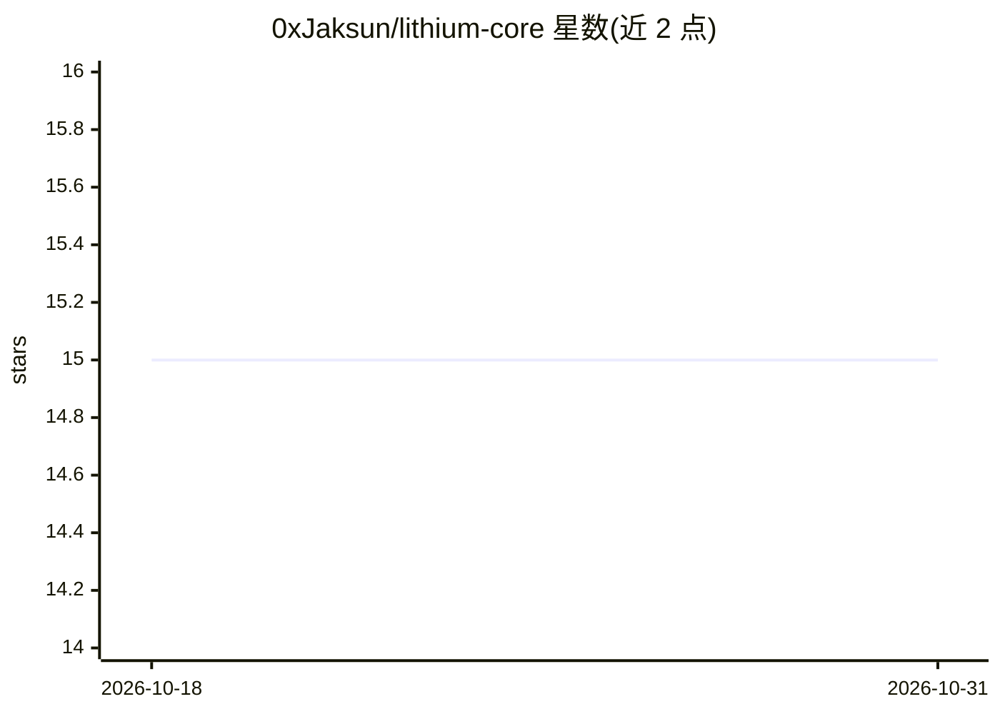

# 0xJaksun/lithium-core

⭐ 15 · TypeScript · MIT · 推送 2026-06-02 · [GitHub](https://github.com/0xJaksun/lithium-core) · [官网](https://www.npmjs.com/package/@lithium-ai/core) · 个人维护

**供 AI agent 存取结构化数据的 PostgreSQL 存储引擎**

基于 PostgreSQL ltree 的分层存储引擎：以树状 cluster 组织数据，按路径做确定性的范围检索，条目带内置不可变版本管理，内容存放在用户自己的表并通过回调读写。提供 TypeScript API（零运行时依赖的 core、postgres/drizzle 适配器）与 MCP 服务器，向 Claude Code、Cursor 等 MCP 客户端暴露 list_clusters、get_context 等四个工具，并支持通过 hooks 在 agent 工作流中自动读写上下文。面向需要结构化数据层的 AI agent 开发者。

## 筛选速览

| 维度 | 判定 | 备注 |
|---|---|---|
| AI 角色 | `ai-ecosystem` | LLM/agent 周边工具 |
| 许可风险 | `permissive` | MIT |
| 部署形态 | `library` | 以包/库形式分发 |
| 模型依赖 | — | README 未给出锁定关系 |
| 硬件要求 | — | 无带数字的原话,不猜 |
| 安装摩擦 | `low` | 无编译、无系统依赖或容器化 |
| 成熟度 | — | 结构信号不足 |

## 能力要点

- PostgreSQL ltree 索引的分层路径检索（scoped query）
- 条目内置不可变版本管理，更新自动递增版本号
- MCP 服务器暴露 4 个工具，兼容 Claude Code / Cursor / Windsurf 等 MCP 客户端
- 内容存于用户自己的表，通过读写回调集成

## 适用场景

- 给 AI agent 提供结构化、可按路径范围检索的数据层
- 团队决策记录与配置的版本化管理
- 按层级组织的文档结构存储与自动上下文注入（hooks）

## 场景标签

`Agent 记忆` · 领域:Agent 开发

## 证据(README 行号)

> L3: The storage engine for AI agents to navigate, store, and retrieve structured data. Hierarchical, versioned, scoped. 
> L85: Your AI tools get four MCP tools:
> L161: |`@lithium-ai/mcp`|MCP server for AI tools.|

## 星数曲线

2026-10-18 15 → 2026-10-31 15（+0）

---
*卡片 v1 · prompt 1.4 · 生成 2026-10-31 · 置信度 high · 依据 README sha `7863c796258e` · [字段定义](../../DATASET.md)*
