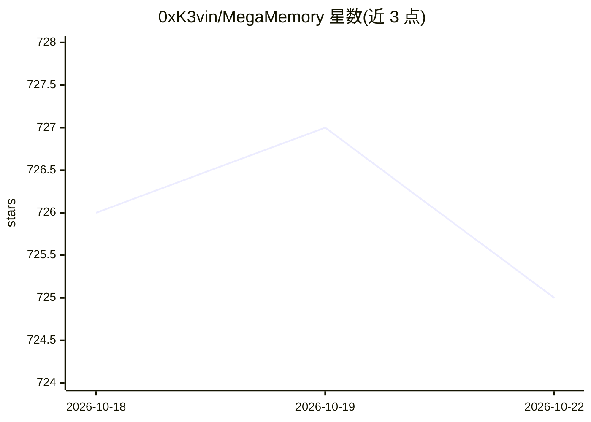

# 0xK3vin/MegaMemory

⭐ 725 · TypeScript · MIT · 推送 2026-05-03 · [GitHub](https://github.com/0xK3vin/MegaMemory) · 个人维护

**给编码代理的持久化项目知识图谱 MCP 服务器**

面向 coding agent 的 MCP 服务器：让 agent 在会话间记忆项目概念、架构与决策。不解析 AST，由 LLM 阅读代码后用自己的话写入概念节点，任务前用自然语言查询，任务后更新。数据存于每项目的 SQLite（.megamemory/knowledge.db），嵌入用进程内 all-MiniLM-L6-v2（ONNX 量化，约 23MB），无 API key。提供 9 个 MCP 工具、两库合并与冲突处理命令，以及浏览器可视化图谱的 web explorer。可通过一条命令配置 opencode、Claude Code、Codex 等客户端。

## 筛选速览

| 维度 | 判定 | 备注 |
|---|---|---|
| AI 角色 | `ai-ecosystem` | LLM/agent 周边工具 |
| 许可风险 | `permissive` | MIT |
| 部署形态 | `library` | 以包/库形式分发 |
| 模型依赖 | locked-api |  |
| 硬件要求 | — | 无带数字的原话,不猜 |
| 安装摩擦 | `low` | 无编译、无系统依赖或容器化 |
| 成熟度 | — | 结构信号不足 |

## 能力要点

- LLM 作为索引器：写入概念而非代码符号，跨会话持久化
- 进程内嵌入（all-MiniLM-L6-v2 ONNX），无需 API key 与网络调用
- SQLite WAL 存储 + 双向合并与冲突检测/解决（含 AI 辅助解决）
- megamemory serve 提供 web 图谱浏览器

## 适用场景

- 让我的编码代理在多会话间记住项目架构与决策
- 在 Claude Code/opencode/Codex 中接入项目知识库
- 分支并行开发后合并两份知识图谱并解决冲突
- 在浏览器中可视化浏览项目概念图

## 场景标签

`知识图谱` `Agent 记忆` · 领域:Agent 开发

## 证据(README 行号)

> L13: An MCP server that lets your coding agent build and query a graph of concepts, architecture, and decisions — so it 
> L15: The LLM is the indexer. No AST parsing. No static analysis. Your agent reads code, writes concepts in its own words

## 星数曲线

2026-10-18 726 → 2026-10-22 725（-1）

---
*卡片 v1 · prompt 1.4 · 生成 2026-10-21 · 置信度 high · 依据 README sha `b1f3a3bfc2ed` · [字段定义](../../DATASET.md)*
