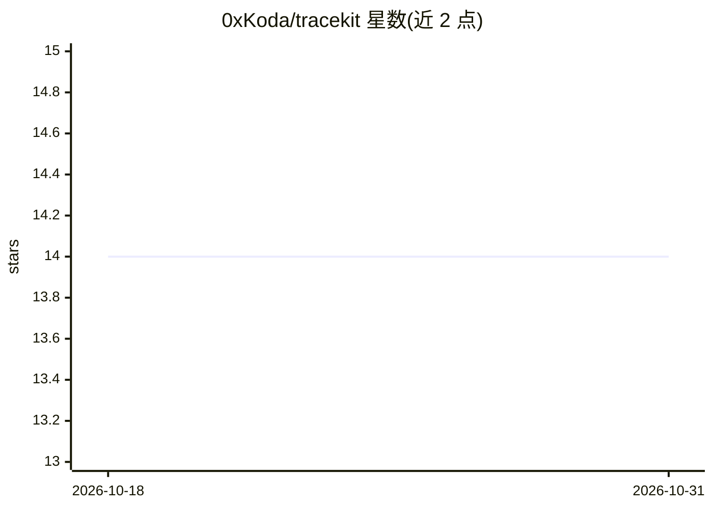

# 0xKoda/tracekit

⭐ 14 · Rust · 推送 2026-02-21 · [GitHub](https://github.com/0xKoda/tracekit) · 个人维护

**Rust CLI：分析 AI 编码 agent 会话记录，定位 token/成本浪费**

用 Rust 编写的命令行工具，读取 Claude Code、OpenCode、Codex、Pi、Kodo 五种编码 agent 的本地会话文件，运行确定性的规则检测器（RETRY_LOOP、EDIT_CASCADE、CONTEXT_BLOAT 等 7 类），输出每项发现的轮次证据、估计浪费 token、估计成本与置信度，并可生成 table/JSON/HTML 报告。成本归一化：OpenCode 直接读会话内 cost 字段，Claude Code 按 token 数乘以模型定价目录估算，Codex 仅做结构分析。定价目录覆盖 Claude、GPT、Gemini、Kimi 等模型。LLM 深度分析层为路线图项，尚未实现。

## 筛选速览

| 维度 | 判定 | 备注 |
|---|---|---|
| AI 角色 | `ai-ecosystem` | LLM/agent 周边工具 |
| 许可风险 | `none` | — |
| 部署形态 | `library` | 以包/库形式分发 |
| 模型依赖 | — | README 未给出锁定关系 |
| 硬件要求 | — | 无带数字的原话,不猜 |
| 安装摩擦 | `medium` | 含编译或系统依赖之一 |
| 成熟度 | — | 结构信号不足 |

## 能力要点

- 支持 5 种编码 agent 的会话文件读取与分析
- 7 类确定性低效检测器，含浪费 token/成本估计与置信度
- table/JSON/HTML 三种报告格式，支持按 agent/时间/模型过滤
- 可作为 Claude Code/Codex/OpenCode 的可复用技能（SKILL.md）

## 适用场景

- 排查编码 agent 会话里重复重试、重复读文件等 token 浪费
- 汇总各 agent 会话成本，找出最贵的会话并定位原因
- 生成 HTML 成本报告用于复盘或团队汇报

## 场景标签

`LLM 可观测性` · 领域:评测与运维

## 证据(README 行号)

> L5: A Rust CLI that analyzes coding-agent session traces to identify token/cost inefficiencies and suggest optimizations
> L79: Run inefficiency detection and cost analysis.
> L142: tracekit currently uses deterministic rule-based detectors. The next layer will pass

## 星数曲线

2026-10-18 14 → 2026-10-31 14（+0）

---
*卡片 v1 · prompt 1.4 · 生成 2026-10-31 · 置信度 high · 依据 README sha `de744d86c796` · [字段定义](../../DATASET.md)*
