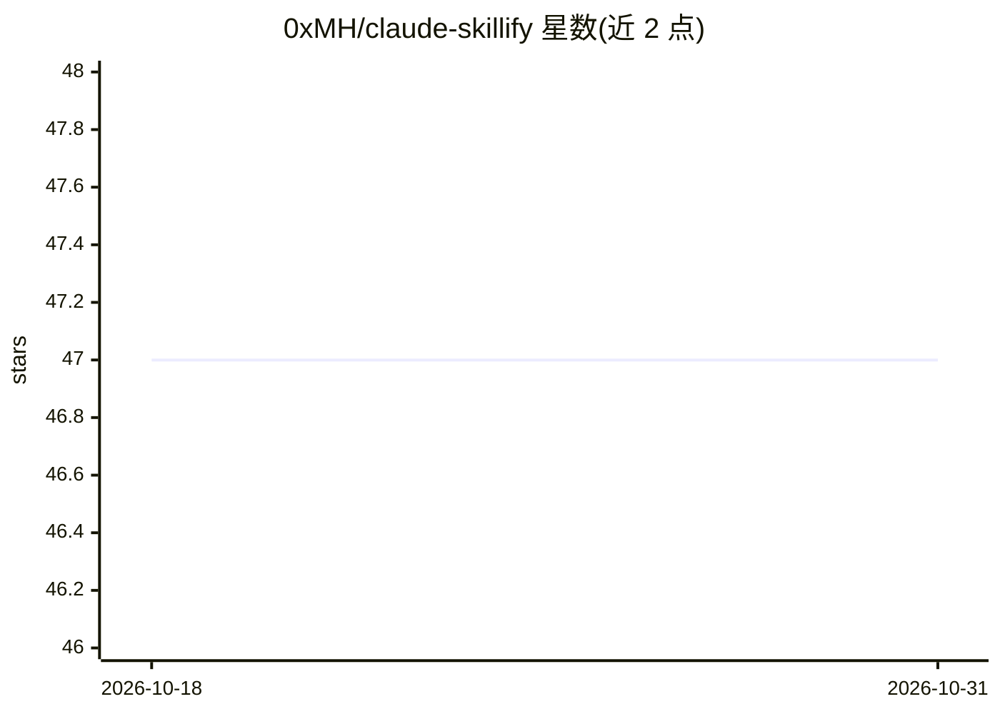

# 0xMH/claude-skillify

⭐ 47 · MIT · 推送 2026-04-01 · [GitHub](https://github.com/0xMH/claude-skillify) · 个人维护

**Claude Code 插件：把会话中的重复流程生成为可复用 SKILL.md**

将 Anthropic 内部仅员工可用的 /skillify 技能移植为公开的 Claude Code 插件。在完成一次可重复流程（部署、PR 审查、cherry-pick 等）的会话后运行 /skillify，它会分析会话历史、交互式确认技能名称与步骤，生成含 frontmatter、成功标准与执行注解的结构化 SKILL.md，供后续以斜杠命令调用。原内部版本依赖二进制内 hooks 注入会话记忆，此版本改为让模型直接分析完整对话历史，访谈流程与输出格式与原版一致。通过 Claude Code 插件市场安装。

## 筛选速览

| 维度 | 判定 | 备注 |
|---|---|---|
| AI 角色 | `ai-ecosystem` | LLM/agent 周边工具 |
| 许可风险 | `permissive` | MIT |
| 部署形态 | `None` |  |
| 模型依赖 | — | README 未给出锁定关系 |
| 硬件要求 | — | 无带数字的原话,不猜 |
| 安装摩擦 | `low` | 无编译、无系统依赖或容器化 |
| 成熟度 | — | 结构信号不足 |

## 能力要点

- 分析会话历史识别流程步骤、工具使用与修正
- 交互式访谈确认技能名、步骤、参数与保存位置
- 生成含 frontmatter、成功标准、执行注解（Direct/Task agent/Teammate/human）的 SKILL.md
- 移植自 Anthropic 内部技能，去除了内部 hooks 依赖

## 适用场景

- 把一次部署或 PR 审查流程沉淀为可复用技能
- 团队内共享通过斜杠命令调用的标准化工作流
- 为不可逆操作步骤设置人工检查点

## 场景标签

`提示工程` · 领域:Agent 开发

## 证据(README 行号)

> L3: I was reading through the Claude Code source code and noticed a skill called `/skillify` that only Anthropic employe
> L13: At the end of a session where you performed a repeatable process (deploy flow, PR review, cherry-pick, etc.), run `

## 星数曲线

2026-10-18 47 → 2026-10-31 47（+0）

---
*卡片 v1 · prompt 1.4 · 生成 2026-10-25 · 置信度 high · 依据 README sha `0c9f5f4213b4` · [字段定义](../../DATASET.md)*
