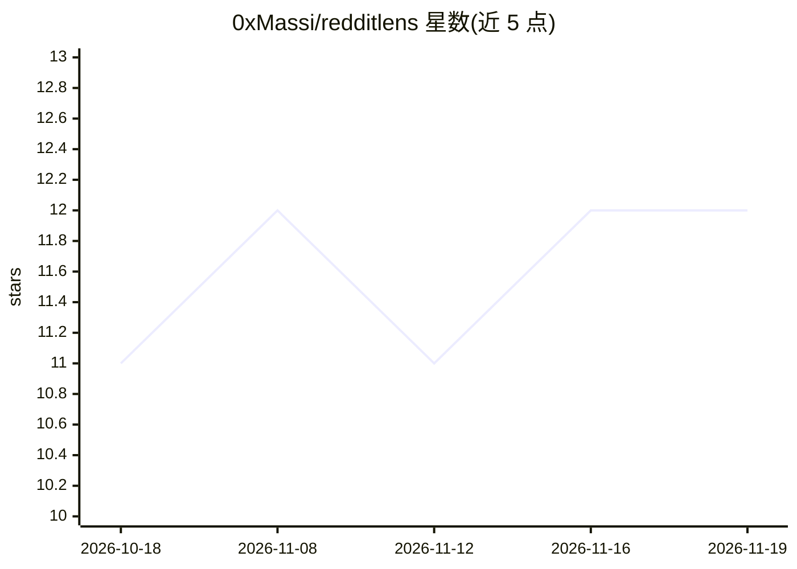

# 0xMassi/redditlens

⭐ 12 · TypeScript · MIT · 推送 2026-04-15 · [GitHub](https://github.com/0xMassi/redditlens) · 个人维护

**帮创始人和独立开发者在 Reddit 上发现痛点并起草回复的 CLI**

redditlens 是一个 Node.js CLI，兼作 Claude Code 技能：通过 Serper（Google 搜索包装）按痛点语言检索 Reddit 帖子，再经 Reddit 公开 .json 端点拉取分数与热评；聚合与起草回复由用户侧的 agent（如 Claude）完成。默认礼貌模式限速 1 请求/秒并对 429 指数退避，高量场景可配置代理轮换。输出为 stdout 上的 JSON，仅需 Node 18+ 与免费 Serper API key，单一依赖 undici，MIT 许可。

## 筛选速览

| 维度 | 判定 | 备注 |
|---|---|---|
| AI 角色 | `ai-native` | 本体是模型或模型工具 |
| 许可风险 | `permissive` | MIT |
| 部署形态 | `library` | 以包/库形式分发 |
| 模型依赖 | — | README 未给出锁定关系 |
| 硬件要求 | — | 无带数字的原话,不猜 |
| 安装摩擦 | `low` | 无编译、无系统依赖或容器化 |
| 成熟度 | — | 结构信号不足 |

## 能力要点

- CLI 输出 JSON，可管道给 jq 或任意 agent/脚本解析
- 通过 Reddit 公开 .json 端点获取数据，无需 Reddit API key 与数据库
- 默认 1 请求/秒限速与 429 指数退避；可选代理列表轮换实现高量模式
- 提供 SKILL.md，可安装为 Claude Code 技能由 Claude 引导五问并起草回复

## 适用场景

- 在开发产品前验证某个痛点是否真实存在
- 找到可以真诚提供帮助的目标用户讨论帖并起草回复
- 把检索结果作为更大 agent 研究流水线的一环

## 场景标签

`网页抓取` `科研工具` · 领域:效率与自动化

## 证据(README 行号)

> L3:  Find real pain points on Reddit. Draft replies that actually get upvoted.
> L14: 4. Your agent clusters the pain points and drafts replies that lead with empathy and value.
> L188: redditlens *does* use an LLM — the Claude Code skill clusters pain points and drafts replies. But the LLM operates

## 星数曲线

2026-10-18 11 → 2026-11-19 12（+1）

---
*卡片 v1 · prompt 1.4 · 生成 2026-11-18 · 置信度 high · 依据 README sha `f4f3e7ea3110` · [字段定义](../../DATASET.md)*
