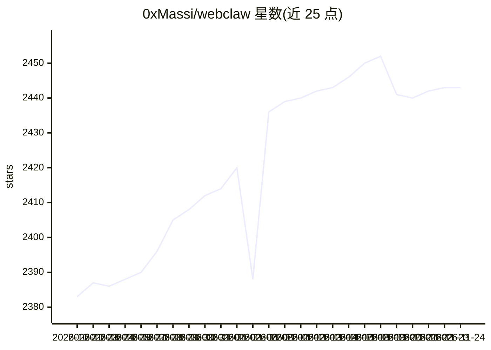

# 0xMassi/webclaw

⭐ 2,443 · Rust · AGPL-3.0 · 推送 2026-11-21 · [GitHub](https://github.com/0xMassi/webclaw) · [官网](https://webclaw.io) · 个人维护

**面向 AI agent 与 RAG 的本地网页内容提取工具（CLI/MCP/REST）**

Rust 编写的本地网页提取工具：将 URL 转为 markdown、JSON 或 LLM 优化的文本，支持抓取单页、爬取站点、CSS/XPath 选择器取值、表格转 JSON、按文本查找元素、按问题筛选段落、生成检索用分块与编号引用。提供 CLI、MCP server、REST API 与 SDK，可通过 npx 安装器接入 MCP 兼容客户端，也可自托管服务器；托管版 API 为 webclaw.io。无 API key，Windows 原生 ZIP 安装需 Visual C++ 运行库。

## 筛选速览

| 维度 | 判定 | 备注 |
|---|---|---|
| AI 角色 | `ai-ecosystem` | LLM/agent 周边工具 |
| 许可风险 | `viral` | AGPL-3.0 |
| 部署形态 | `desktop` | 安装包/桌面程序 |
| 模型依赖 | — | README 未给出锁定关系 |
| 硬件要求 | — | 无带数字的原话,不猜 |
| 安装摩擦 | `low` | 无编译、无系统依赖或容器化 |
| 成熟度 | — | 结构信号不足 |

## 能力要点

- CLI、MCP server、REST API、Python 包多种使用方式
- CSS/XPath 选择器、--tables、--find-text/--similar 等结构化提取
- --chunk 生成带 heading_path 与 token 估算的 RAG 分块
- JavaScript 渲染页面后提取，无需 API key

## 适用场景

- 为 AI agent 提供干净的网页上下文而非原始 HTML
- 把文档站爬取并分块后建检索索引
- 从列表页批量抽取结构化字段为 JSON
- 通过 MCP 在 Claude Code/Cursor 等客户端中调用网页提取

## 场景标签

`网页抓取` `文档解析` · 领域:效率与自动化

## 证据(README 行号)

> L10:  CLI, MCP server, REST API, and SDKs for AI agents and RAG pipelines.
> L31: webclaw.io is the hosted web extraction API for webclaw. This repo contains the open-source CLI, MCP server, extrac

## 星数曲线

2026-10-21 2,383 → 2026-11-24 2,443（+60）

---
*卡片 v1 · prompt 1.4 · 生成 2026-11-23 · 置信度 high · 依据 README sha `929ab3294e8f` · [字段定义](../../DATASET.md)*
