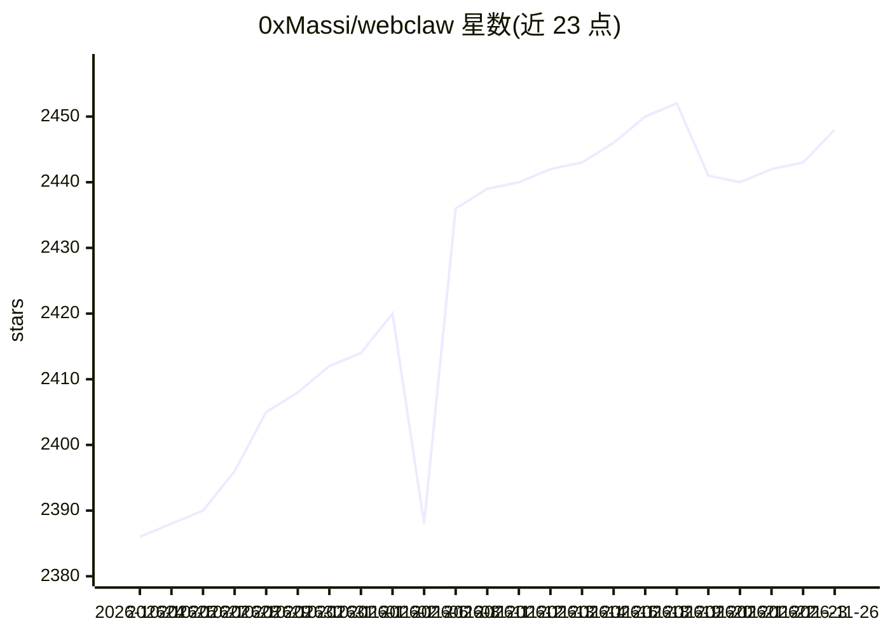

# 0xMassi/webclaw

⭐ 2,448 · Rust · AGPL-3.0 · 推送 2026-11-25 · [GitHub](https://github.com/0xMassi/webclaw) · [官网](https://webclaw.io) · 个人维护 · 中文 README

**为 LLM 与 RAG 管线提取网页内容的本地工具（CLI/MCP/API）**

Rust 实现的本地网页内容提取工具：将 URL 转为干净的 markdown、JSON 或 LLM 优化文本，支持抓取单页、爬取多页、按 CSS/XPath 选择器提取字段、表格转 JSON、按文本查找元素与相似元素扩展、按问题筛选段落、按 token 分块输出供检索索引用，以及链接编号引用。提供 CLI、MCP server、REST API、SDK（Cargo/Python）与可自托管服务器；官方托管版为 webclaw.io，本仓库为开源部分。无需 API key 即可本地运行。

## 筛选速览

| 维度 | 判定 | 备注 |
|---|---|---|
| AI 角色 | `ai-ecosystem` | LLM/agent 周边工具 |
| 许可风险 | `viral` | AGPL-3.0 |
| 部署形态 | `desktop` | 安装包/桌面程序 |
| 模型依赖 | — | README 未给出锁定关系 |
| 硬件要求 | — | 无带数字的原话,不猜 |
| 安装摩擦 | `low` | 无编译、无系统依赖或容器化 |
| 成熟度 | — | 结构信号不足 |

## 能力要点

- CLI、MCP server、REST API、SDK（Cargo/Python）多种接入方式
- 支持 --chunk 分块、--query 问题筛选、--citations 引用编号等 LLM 适配输出
- 支持 CSS/XPath 选择器、--field 结构化字段、--tables 表格转 JSON、--similar 相似元素扩展
- 含 JS 渲染、爬取（--crawl）与本地运行，无需 API key

## 适用场景

- 为 RAG 管线生成带 heading_path 的检索分块
- 给 AI agent 提供 MCP 方式的网页抓取与结构化提取
- 把文档站批量爬取并转为 markdown/LLM 优化文本
- 从列表页用选择器批量抽取字段生成 JSON 记录

## 场景标签

`网页抓取` `RAG` · 领域:效率与自动化

## 证据(README 行号)

> L9:  Turn websites into clean markdown, JSON, and LLM-ready context.
> L10:  CLI, MCP server, REST API, and SDKs for AI agents and RAG pipelines.
> L31: webclaw.io is the hosted web extraction API for webclaw. This repo contains the open-source CLI, MCP server, extrac

## 星数曲线

2026-10-24 2,386 → 2026-11-26 2,448（+62）

---
*卡片 v1 · prompt 1.4 · 生成 2026-11-25 · 置信度 high · 依据 README sha `94b7e58824fa` · [字段定义](../../DATASET.md)*
