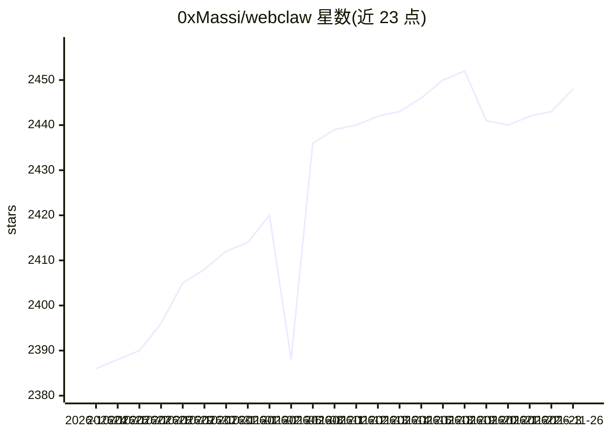

# 0xMassi/webclaw

⭐ 2,448 · Rust · AGPL-3.0 · 推送 2026-11-25 · [GitHub](https://github.com/0xMassi/webclaw) · [官网](https://webclaw.io) · 个人维护 · 中文 README

**面向 LLM 的本地网页内容提取工具：抓取、爬取并输出结构化数据**

Rust 编写的网页提取工具，把 URL 转为干净的 markdown、JSON 或 LLM 就绪文本。功能覆盖单页抓取、爬取、CSS/XPath 选择器取值、表格转 JSON、按文本查找元素、按问题筛选段落、为检索生成带 heading_path 与 token 估计的分块、链接转编号引用。通过 CLI、REST API、MCP server 与 Python 包（捆绑二进制、无 API key、无 Python 依赖）提供；发布到 npm，另附 Homebrew、预编译二进制、Cargo 源码构建与 Docker 镜像，服务端可自托管。

## 筛选速览

| 维度 | 判定 | 备注 |
|---|---|---|
| AI 角色 | `ai-enhanced` | 去掉 AI 部分产品仍成立 |
| 许可风险 | `viral` | AGPL-3.0 |
| 部署形态 | `desktop` | 安装包/桌面程序 |
| 模型依赖 | — | README 未给出锁定关系 |
| 硬件要求 | — | 无带数字的原话,不猜 |
| 安装摩擦 | `low` | 无编译、无系统依赖或容器化 |
| 成熟度 | — | 结构信号不足 |

## 能力要点

- CLI、REST API、MCP server 与 Python 包多形态分发
- CSS 选择器、XPath、--find-text/--similar 与表格转 JSON 的结构化提取
- --chunk 输出带 heading_path 与 token 估计的 RAG 分块，--query 按问题筛段落
- 预编译二进制与捆绑二进制的 Python 包，无需 API key

## 适用场景

- 为 AI agent 或 RAG 管道抓取网页并生成干净上下文
- 把搜索索引的分块与结构化字段提取交给本地工具
- 通过 MCP 从 Claude Code、Cursor 等客户端调用网页提取

## 场景标签

`网页抓取` · 领域:效率与自动化

## 证据(README 行号)

> L9:  Turn websites into clean markdown, JSON, and LLM-ready context.
> L10:  CLI, MCP server, REST API, and SDKs for AI agents and RAG pipelines.
> L47: Use it from the terminal, wire it into Claude/Cursor through MCP, call the hosted API from your app, or self-host t

## 星数曲线

2026-10-24 2,386 → 2026-11-26 2,448（+62）

---
*卡片 v1 · prompt 1.4 · 生成 2026-11-26 · 置信度 high · 依据 README sha `0638826aad59` · [字段定义](../../DATASET.md)*
