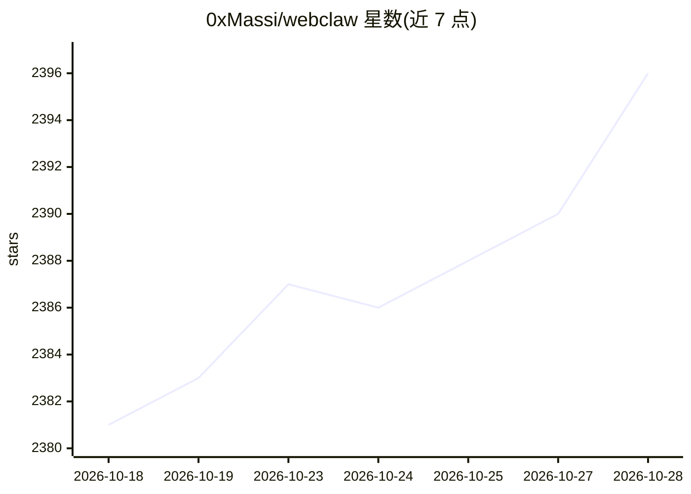

# 0xMassi/webclaw

⭐ 2,396 · Rust · AGPL-3.0 · 推送 2026-10-27 · [GitHub](https://github.com/0xMassi/webclaw) · [官网](https://webclaw.io) · 个人维护 · 中文 README

**面向 LLM/Agent 的本地网页抽取工具：网页转 Markdown/JSON/LLM 上下文**

Rust 编写的网页内容抽取引擎，将 URL 转为干净的 Markdown、JSON、纯文本或 LLM 优化格式，支持单页抓取、同域爬取、URL 发现、批量并行抓取、结构化抽取、页面快照对比与品牌资产（颜色/字体/Logo）提取。以 CLI、MCP server、可自托管 REST 服务和 TS/Python/Go SDK 形式提供。核心抽取路径本地运行无需账号，JavaScript 渲染、受保护站点访问、Web 搜索等由 webclaw.io 托管 API 提供；extract/summarize 可接本地或配置的 LLM。

## 筛选速览

| 维度 | 判定 | 备注 |
|---|---|---|
| AI 角色 | `ai-ecosystem` | LLM/agent 周边工具 |
| 许可风险 | `viral` | AGPL-3.0 |
| 部署形态 | `desktop` | 安装包/桌面程序 |
| 模型依赖 | local-ok | 支持本地模型 |
| 硬件要求 | — | 无带数字的原话,不猜 |
| 安装摩擦 | `low` | 无编译、无系统依赖或容器化 |
| 成熟度 | — | 结构信号不足 |

## 能力要点

- 10 个工具：scrape/crawl/map/batch/extract/summarize/diff/brand/search/research，多数本地运行
- MCP server 零安装接入 Claude Code/Cursor/Windsurf 等 MCP 客户端
- CLI 与 MCP server 核心抽取路径本地运行，无需账号与 API key
- 提供 Firecrawl 兼容 API 与代理池配置

## 适用场景

- 为 Claude/Cursor 等 agent 提供干净的网页上下文
- 爬取文档站并生成 RAG 索引素材
- 追踪竞品定价页/更新日志的页面变化
- 把杂乱页面转为结构化 JSON 供自动化使用

## 场景标签

`网页抓取` · 领域:效率与自动化

## 证据(README 行号)

> L9:  Turn websites into clean markdown, JSON, and LLM-ready context.
> L10:  CLI, MCP server, REST API, and SDKs for AI agents and RAG pipelines.
> L188: webclaw ships with an MCP server for AI agents.
> L291: The CLI and MCP server work locally without an account for the core extraction path.

## 星数曲线

2026-10-18 2,381 → 2026-10-28 2,396（+15）

---
*卡片 v1 · prompt 1.4 · 生成 2026-10-21 · 置信度 mid · 依据 README sha `693152a96ff3` · [字段定义](../../DATASET.md)*
