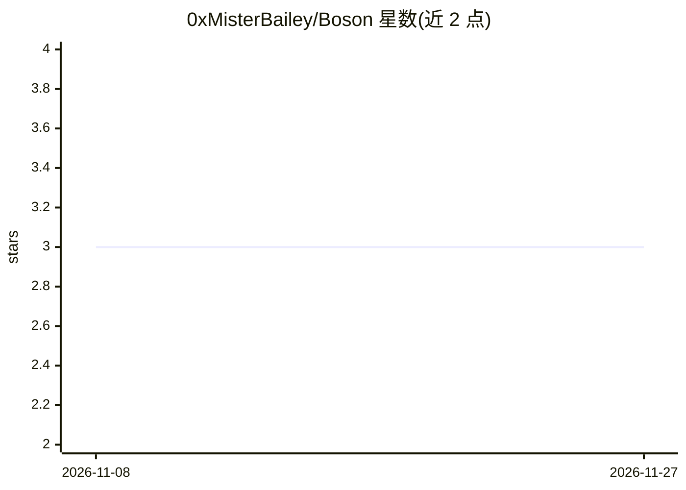

# 0xMisterBailey/Boson

⭐ 3 · Python · MIT · 推送 2026-10-30 · [GitHub](https://github.com/0xMisterBailey/Boson) · 个人维护

**ComfyUI 节点包与应用：用 git studio 沉淀图像生成的品味反馈环**

Boson 是一个 ComfyUI 节点包（28 个节点）及随附 Web 应用，围绕一个反馈循环构建：生成一轮图像后打绿/红点并写一句话评判，该评判以 git commit 形式写入 studio（STUDIO.md/TASTE.json/LOOP.jsonl 等普通文件），下一轮生成必须读取。评判者可以是应用中的用户、脚本或命令行 AI agent。内置 15 个 studio 与 3 个 scene，全部以 git bundle 携带完整历史。运行需已有 ComfyUI 与 git，不支持 GPU 的机器可用 --cpu 运行。

## 筛选速览

| 维度 | 判定 | 备注 |
|---|---|---|
| AI 角色 | `ai-native` | 本体是模型或模型工具 |
| 许可风险 | `permissive` | MIT |
| 部署形态 | `None` |  |
| 模型依赖 | — | README 未给出锁定关系 |
| 硬件要求 | `cpu-ok` | |
| 安装摩擦 | `low` | 无编译、无系统依赖或容器化 |
| 成熟度 | — | 结构信号不足 |

## 能力要点

- 评判以 git commit 沉淀为 studio 状态，可 diff、分支与分享
- 节点支持 stored 免费回放（无需 key 与网络）或 live 模式
- 模型接入由一个开关控制：open weights 全本地、全云或混合
- 支持脚本或 AI agent 通过命令行担任评判者

## 适用场景

- 在 ComfyUI 中通过多轮评判迭代收敛图像风格
- 把个人审美以 git 文件形式管理并分享给他人
- 让 agent 自动画出、评判并生成整套场景

## 场景标签

`图像生成` · 领域:内容生成

## 证据(README 行号)

> L7: Boson is a ComfyUI node pack, and an app served by the same ComfyUI, built around one feedback loop: make a round,
> L14: - **28 nodes and an app** (`/boson/app`) on plain ComfyUI. No Python packages beyond ComfyUI's own; `git` on `PATH`
> L77: 1. **Make.** The writer (an LLM) reads the whole studio, its practice, its pins and every verdict so far, and write

## 星数曲线

2026-11-08 3 → 2026-11-27 3（+0）

---
*卡片 v1 · prompt 1.4 · 生成 2026-11-26 · 置信度 high · 依据 README sha `1e6d4a14902f` · [字段定义](../../DATASET.md)*
