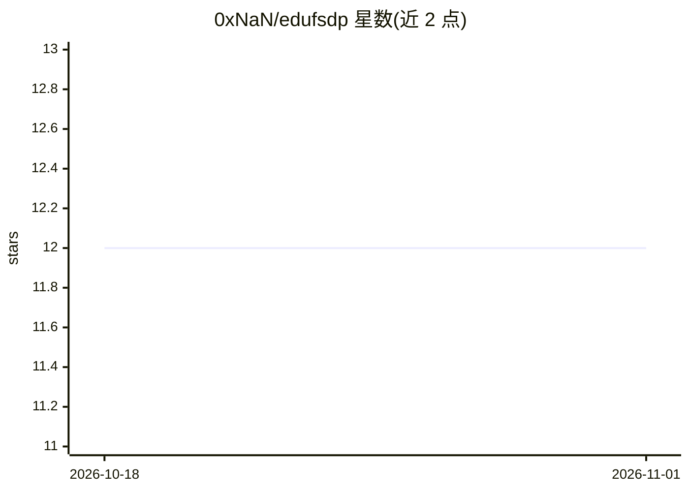

# 0xNaN/edufsdp

⭐ 12 · Python · 推送 2026-01-26 · [GitHub](https://github.com/0xNaN/edufsdp) · 个人维护

**面向教学的 FSDP 最小实现：展示分布式训练分片机制**

从 PyTorch FSDP 代码库中提取核心机制的最小化教学实现：参数、梯度与优化器状态按 FULL_SHARD 策略在数据并行 rank 间分片，提供基于策略的自动包裹（wrap_fn）与激活检查点。明确声明缺少官方版优化：集合通信为阻塞式无预取、不支持混合精度、不使用 meta device、无 CPU offloading。附带训练脚本，可用 Qwen2-0.5 在 TinyStories 上与官方 torch FSDP 对比，无 GPU 时可经 GLOO 后端在 CPU 上运行。

## 筛选速览

| 维度 | 判定 | 备注 |
|---|---|---|
| AI 角色 | `ai-ecosystem` | LLM/agent 周边工具 |
| 许可风险 | `none` | — |
| 部署形态 | `library` | 以包/库形式分发 |
| 模型依赖 | — | README 未给出锁定关系 |
| 硬件要求 | — | 无带数字的原话,不猜 |
| 安装摩擦 | `low` | 无编译、无系统依赖或容器化 |
| 成熟度 | — | 结构信号不足 |

## 能力要点

- FULL_SHARD 策略分片参数/梯度/优化器状态
- 基于策略函数（wrap_fn）的自动包裹与分片
- 支持激活检查点以节省前向/反向显存
- 提供与官方 torch FSDP 的对比训练脚本

## 适用场景

- 学习 FSDP 的状态机与分片/收集通信机制
- 在小型模型上对比自实现与官方 FSDP 的显存与耗时
- 无 GPU 环境下用 CPU/GLOO 后端跑通分布式训练流程

## 场景标签

`模型训练` · 领域:训练与推理

## 证据(README 行号)

> L3: A minimal and educational implementation of Fully Sharded Data Parallel (FSDP).
> L13: - _Parameter Sharding_: Implements a `FULL_SHARD` strategy, where model parameters, gradients, and optimizer states

## 星数曲线

2026-10-18 12 → 2026-11-01 12（+0）

---
*卡片 v1 · prompt 1.4 · 生成 2026-11-01 · 置信度 high · 依据 README sha `c4aaee521715` · [字段定义](../../DATASET.md)*
