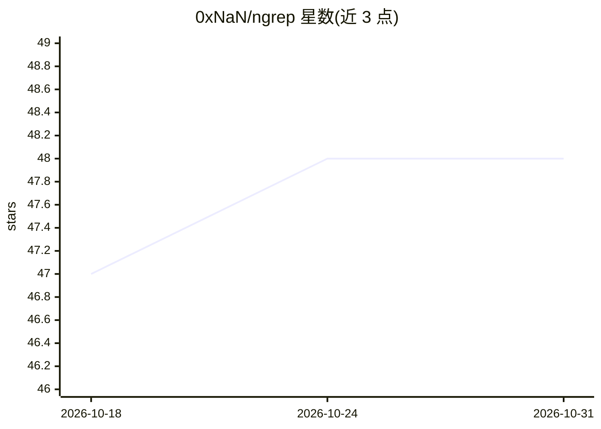

# 0xNaN/ngrep

⭐ 48 · Rust · 推送 2026-03-22 · [GitHub](https://github.com/0xNaN/ngrep) · 个人维护

**用词向量做语义匹配的 grep 扩展 CLI 工具**

Rust 编写的实验性 PoC 命令行工具，在正则表达式中新增神经算子 `~`，通过 Word Embeddings 按语义相似度匹配文本，其余正则语法（含前后查找）保持不变，基于 fancy-regex 构建。支持阈值参数、多词平均向量等语法，可导入 FastText、Wikipedia2Vec、GloVe 等 txt 格式词向量模型，一次使用一个模型。当前版本不预载或缓存向量、频繁磁盘访问，性能非优化重点（M4 上处理 1.2MB 文本约 18 秒）。面向需要按含义而非字面查找文本的用户，通过 cargo 从源码构建安装。

## 筛选速览

| 维度 | 判定 | 备注 |
|---|---|---|
| AI 角色 | `ai-native` | 本体是模型或模型工具 |
| 许可风险 | `none` | — |
| 部署形态 | `library` | 以包/库形式分发 |
| 模型依赖 | — | README 未给出锁定关系 |
| 硬件要求 | — | 无带数字的原话,不猜 |
| 安装摩擦 | `medium` | 含编译或系统依赖之一 |
| 成熟度 | `idea` | |

## 能力要点

- 在正则中扩展 `~` 神经算子，按词向量语义相似度匹配
- 支持阈值覆盖 `~(word;0.3)` 与多词平均向量 `~(word1::word2)`
- 兼容主流正则特性（含负向前查找），基于 fancy-regex
- 可导入 FastText/Wikipedia2Vec/GloVe 等多种 txt 格式词向量模型

## 适用场景

- 在文本中按语义而非字面查找近义词或短语
- 结合语义与字面模式在一个正则表达式中检索
- 探索词向量增强正则表达式的检索方式

## 场景标签

`语义搜索` · 领域:知识与检索

## 证据(README 行号)

> L5: `ngrep` is an experimental PoC for finding text by meaning rather than literal matching. The core question is simple
> L11: The `~` operator matches by _semantic_ similarity, using neural Word Embeddings (yes, 2010s nostalgia).

## 星数曲线

2026-10-18 47 → 2026-10-31 48（+1）

---
*卡片 v1 · prompt 1.4 · 生成 2026-10-25 · 置信度 high · 依据 README sha `b5e3d3dd631e` · [字段定义](../../DATASET.md)*
