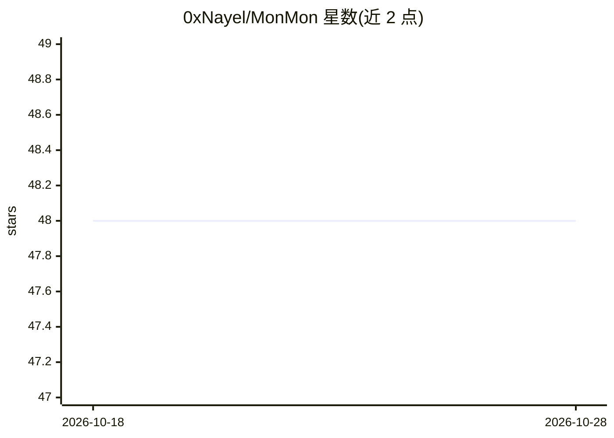

# 0xNayel/MonMon

⭐ 47 · TypeScript · MIT · 推送 2026-04-07 · [GitHub](https://github.com/0xNayel/MonMon) · 个人维护

**面向赏金猎人的自动化变更监控与告警工具**

MonMon 用 Go 编写，面向漏洞赏金猎人，按设定间隔对四类对象做持续监控：shell 命令输出、HTTP 端点响应、子域名（subfinder+httpx 流水线）、以及 HackerOne/Bugcrowd/Intigriti/YesWeHack 的赏金范围。每次结果与完整任务历史做 unified diff，变化时通过 Slack/Discord/Telegram/Webhook 告警，支持关键词过滤与 Go 模板变量。内嵌 React SPA 仪表盘（diff 查看器、实时日志）。提供 Docker 镜像、go install 与源码构建三种安装方式；仅 subdomain/bbscope 任务需 subfinder/httpx/bbscope 依赖。README 未描述 AI 功能，仓库标签含 ai-powered 但无对应实现说明。

## 筛选速览

| 维度 | 判定 | 备注 |
|---|---|---|
| AI 角色 | `ai-enhanced` | 去掉 AI 部分产品仍成立 |
| 许可风险 | `permissive` | MIT |
| 部署形态 | `self-host` | docker 或自建部署 |
| 模型依赖 | — | README 未给出锁定关系 |
| 硬件要求 | — | 无带数字的原话,不猜 |
| 安装摩擦 | `low` | 无编译、无系统依赖或容器化 |
| 成熟度 | — | 结构信号不足 |

## 能力要点

- 四类监控任务：command/endpoint/subdomain/bbscope
- 每行新内容对照完整任务历史 diff（非仅上次运行）
- 子域名流水线 subfinder -all → httpx，稳定键输出避免乱序误报
- 多渠道告警（Slack/Discord/Telegram/Webhook）+ 内嵌 React 仪表盘

## 适用场景

- 监控赏金项目范围扩张并在第一时间收到通知
- 持续探测新子域名与 HTTP 端点变更
- 定时执行 nuclei/gau 等命令并对输出做 diff 告警

## 场景标签

`网络安全` · 领域:学习与行业

## 证据(README 行号)

> L28: Monitoring Monster (MonMon) runs your recon on autopilot. Point it at targets, set intervals, and get alerted once 
> L42: |**Monitoring Modes**|`command` · `endpoint` · `subdomain` · `bbscope` — four task types covering shell output, HTT

## 星数曲线

2026-10-18 48 → 2026-10-28 48（+0）

---
*卡片 v1 · prompt 1.4 · 生成 2026-10-25 · 置信度 low · 依据 README sha `1182f36884f7` · [字段定义](../../DATASET.md)*
