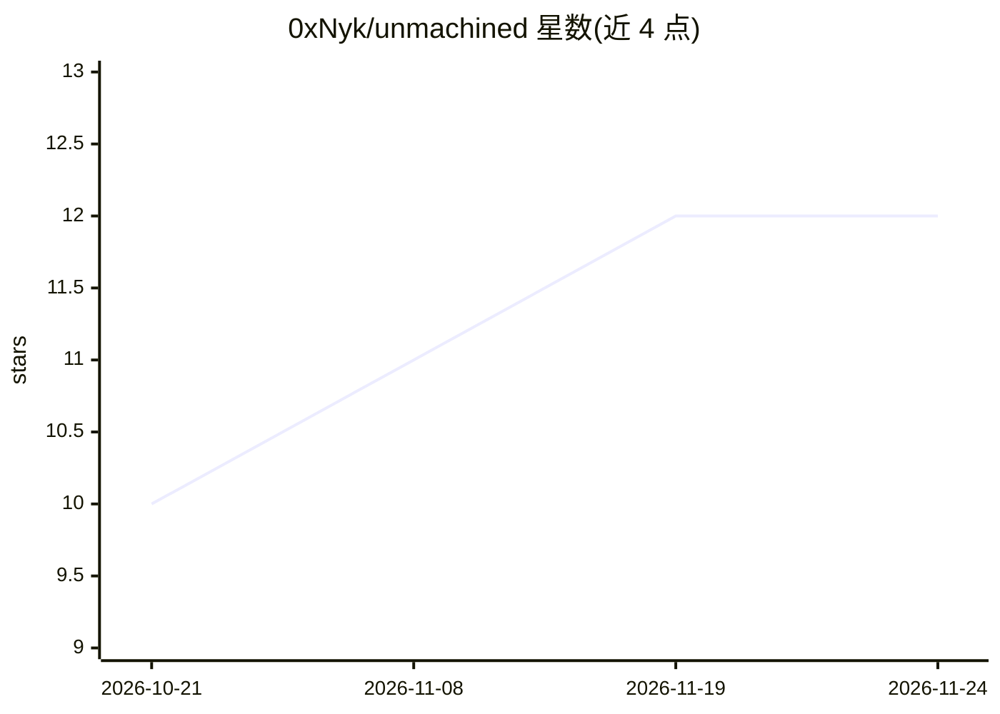

# 0xNyk/unmachined

⭐ 12 · Python · MIT · 推送 2026-11-01 · [GitHub](https://github.com/0xNyk/unmachined) · 个人维护

**给 agent 的去 AI 腔技能：扫描并修整文本与 UI 模板痕迹**

一个供 Claude Code、Codex、Cursor、Hermes 等 agent 主机加载的技能包，通过确定性扫描脚本对文本与界面代码打 0-100 分（默认阈值 40，超限退出码 1），按 critical/major/minor 三级严重度输出规则命中、位置与摘录；配以按需加载的规则目录（SKILL.md + references/），要求修复附证据并做结构变化，避免形成新模板。扫描器需 Python 3.8+，无运行时依赖、无网络请求，可用作 CI 门禁。明确声明不可用作作者检测。

## 筛选速览

| 维度 | 判定 | 备注 |
|---|---|---|
| AI 角色 | `ai-ecosystem` | LLM/agent 周边工具 |
| 许可风险 | `permissive` | MIT |
| 部署形态 | `None` |  |
| 模型依赖 | — | README 未给出锁定关系 |
| 硬件要求 | — | 无带数字的原话,不猜 |
| 安装摩擦 | `low` | 无编译、无系统依赖或容器化 |
| 成熟度 | — | 结构信号不足 |

## 能力要点

- 确定性文本/UI 扫描器：0-100 评分、严重度分级、JSON 输出与 CI 门禁示例
- 以符号链接安装到 ~/.claude、~/.codex、~/.cursor、~/.hermes 等多个 agent 主机技能目录
- /unmachined audit|fix|text|ui|diff 等命令式工作流与 always-on 配置开关
- 规则按需渐进加载，无需网络请求与运行时依赖

## 适用场景

- 发布前扫描文档与文案，清除 AI 生成痕迹词句
- 在 CI 中对变更的 markdown 文件做风格门禁
- 审查 UI 代码中的模板化默认样式并按证据修复

## 场景标签

`AI 写作` · 领域:内容生成

## 证据(README 行号)

> L5: An agent skill that removes familiar AI tells from writing and interface work.
> L54: ln -s "$(pwd)" ~/.claude/skills/unmachined
> L138: 1. Catalog known tells by severity and scan deterministic matches before self-review.

## 星数曲线

2026-10-21 10 → 2026-11-24 12（+2）

---
*卡片 v1 · prompt 1.4 · 生成 2026-11-19 · 置信度 high · 依据 README sha `edf6a202d354` · [字段定义](../../DATASET.md)*
