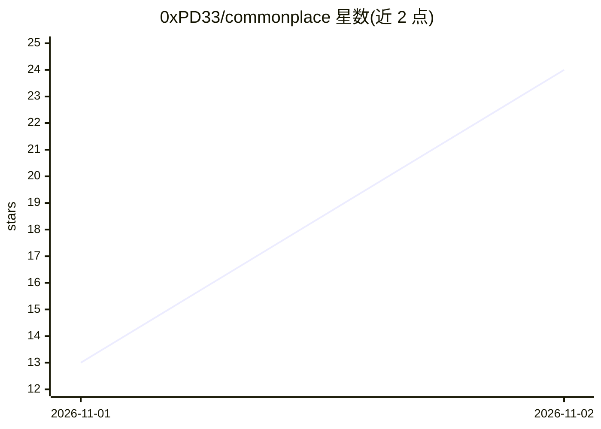

# 0xPD33/commonplace

⭐ 24 · Rust · Apache-2.0 · 推送 2026-10-24 · [GitHub](https://github.com/0xPD33/commonplace) · [官网](https://askcommonplace.app/) · 个人维护

**安卓离线 AI 研究问答应用：本机检索维基百科并给出带引用的回答**

面向终端用户的 Android 离线研究助手：问题在本机对预构建的 Wikipedia/Wikidata 等知识包做检索与重排，再由本地 LLM 生成带引用来源的回答；APK 无 INTERNET 权限，网络由系统层面阻断。Pixel 10 上 Gemma 4 E2B 运行于 Tensor G5 NPU，其他机型通过 llama.cpp 在 CPU 上跑 Ling-3.0-tiny 或 MiniCPM5-2B。知识包由桌面端一次性构建，浏览器下载后导入，总量受 50 GB 上限约束；要求 64 位 ARM、Android 12+、8 GB 以上内存。以 APK 分发，也可从源码构建。

## 筛选速览

| 维度 | 判定 | 备注 |
|---|---|---|
| AI 角色 | `ai-native` | 本体是模型或模型工具 |
| 许可风险 | `permissive` | Apache-2.0 |
| 部署形态 | `None` |  |
| 模型依赖 | local-ok | 支持本地模型 |
| 硬件要求 | — | 无带数字的原话,不猜 |
| 安装摩擦 | `medium` | 含编译或系统依赖之一 |
| 成熟度 | — | 结构信号不足 |

## 能力要点

- 本机检索 + 本地模型生成带引用的回答，全程无网络请求（无 INTERNET 权限）
- Pixel 10 上 Gemma 4 E2B 跑 Tensor G5 NPU，首词约 2 秒
- 其他手机经 llama.cpp 在 CPU 运行 Ling-3.0-tiny 或 MiniCPM5-2B
- 支持导入自有 PDF/文本/Markdown 并对其提问

## 适用场景

- 离线（飞行模式）查询维基百科类资料并获得带引用的回答
- 在无网或隐私敏感环境下做移动端知识问答
- 对比两个实体并引用 Wikidata 事实，或对自有 PDF 提问

## 场景标签

`文档问答` · 领域:知识与检索

## 证据(README 行号)

> L3: Commonplace is an offline research assistant for Android. You ask a question, and it answers from Wikipedia and othe
> L5: On a Pixel 10, Gemma 4 E2B writes the answer on the Tensor G5 NPU: the first word comes after about 2 seconds and th

## 星数曲线

2026-11-01 13 → 2026-11-02 24（+11）

---
*卡片 v1 · prompt 1.4 · 生成 2026-10-31 · 置信度 high · 依据 README sha `0250b28b0e3b` · [字段定义](../../DATASET.md)*
