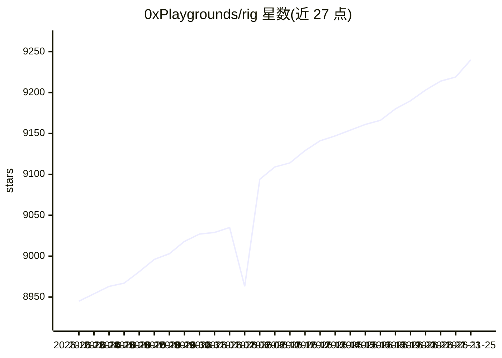

# 0xPlaygrounds/rig

⭐ 9,240 · Rust · MIT · 推送 2026-11-23 · [GitHub](https://github.com/0xPlaygrounds/rig) · [官网](https://rig.rs) · 组织维护

**Rust 库：统一接口构建模块化 LLM 应用，附终端编码 Agent**

Rig 是用于构建大语言模型应用的 Rust 库，将 20 多个模型提供商和十余种向量存储收敛到统一接口，提供带工具、流式输出与类型化钩子的 Agent，覆盖补全、嵌入、转录、音频与图像模型，遵循 OpenTelemetry GenAI 规范，rig-core 与 rig-agent 可构建为浏览器 WASM。库同时附带同名终端编码 Agent：工具、命令、会话、登录与终端视图均以插件形式组织，可用 Bevy 插件关闭、替换或扩展，/reload 可重建 Agent 并保留会话。Agent 需 Rust 1.97.1 或更新版本，运行于 Linux 与 macOS。

## 筛选速览

| 维度 | 判定 | 备注 |
|---|---|---|
| AI 角色 | `ai-ecosystem` | LLM/agent 周边工具 |
| 许可风险 | `permissive` | MIT |
| 部署形态 | `library` | 以包/库形式分发 |
| 模型依赖 | — | README 未给出锁定关系 |
| 硬件要求 | — | 无带数字的原话,不猜 |
| 安装摩擦 | `low` | 无编译、无系统依赖或容器化 |
| 成熟度 | — | 结构信号不足 |

## 能力要点

- 20+ 模型提供商与十余种向量存储统一接口
- 终端编码 Agent 的各组件均为可替换插件
- 覆盖补全、嵌入、转录、音频与图像模型
- rig-core/rig-agent 支持 WASM 构建

## 适用场景

- 用 Rust 构建模块化、可扩展的 LLM 应用
- 通过 Bevy 插件扩展自己的终端编码 Agent
- 在 Rust 项目中统一接入多提供商模型与向量存储

## 场景标签

`Agent 框架` `编码 Agent` `模型网关` · 领域:Agent 开发

## 证据(README 行号)

> L8: Rig is a Rust library for building applications on large language models.
> L54: Rig puts over 20 model providers and a dozen vector stores behind one

## 星数曲线

2026-10-23 8,945 → 2026-11-25 9,240（+295）

---
*卡片 v1 · prompt 1.4 · 生成 2026-11-24 · 置信度 high · 依据 README sha `85afd11d1fdd` · [字段定义](../../DATASET.md)*
