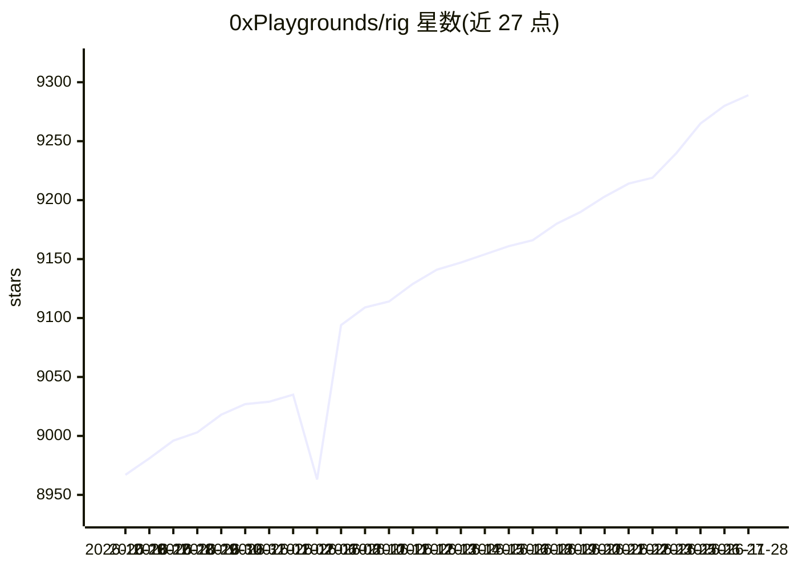

# 0xPlaygrounds/rig

⭐ 9,289 · Rust · MIT · 推送 2026-11-27 · [GitHub](https://github.com/0xPlaygrounds/rig) · [官网](https://rig.rs) · 组织维护

**Rust 库与终端编码 Agent：模块化构建 LLM 应用**

Rig 是一个用于构建大语言模型应用的 Rust 库，将 20 多个模型提供商和十余种向量存储统一在同一接口之后，支持带工具、流式输出与类型化钩子的 agent，覆盖 completion、embedding、转录、音频与图像模型，并遵循 OpenTelemetry GenAI 约定。库还附带基于其构建的终端编码 agent `rig`，其工具、命令、会话等均以 Bevy 插件形式可替换或扩展。`rig-core` 与 `rig-agent` 可构建为浏览器 WASM。运行需 Rust 1.97.1+，支持 Linux 与 macOS。

## 筛选速览

| 维度 | 判定 | 备注 |
|---|---|---|
| AI 角色 | `ai-ecosystem` | LLM/agent 周边工具 |
| 许可风险 | `permissive` | MIT |
| 部署形态 | `library` | 以包/库形式分发 |
| 模型依赖 | — | README 未给出锁定关系 |
| 硬件要求 | — | 无带数字的原话,不猜 |
| 安装摩擦 | `low` | 无编译、无系统依赖或容器化 |
| 成熟度 | — | 结构信号不足 |

## 能力要点

- 20+ 模型提供商与十余种向量存储统一接口
- 终端编码 agent `rig`，全部能力以插件形式可关闭/替换/扩展
- 支持 completion、embedding、转录、音频与图像模型
- rig-core 与 rig-agent 支持浏览器 WASM 构建

## 适用场景

- 用 Rust 构建调用多家模型提供商的 LLM 应用
- 扩展或定制终端编码 agent 的工具与命令
- 统一接入多种向量存储实现检索场景

## 场景标签

`Agent 框架` `编码 Agent` · 领域:Agent 开发

## 证据(README 行号)

> L8: Rig is a Rust library for building applications on large language models.
> L54: Rig puts over 20 model providers and a dozen vector stores behind one
> L55: interface. It has agents with tools, streaming and typed hooks. It covers

## 星数曲线

2026-10-26 8,967 → 2026-11-28 9,289（+322）

---
*卡片 v1 · prompt 1.4 · 生成 2026-11-27 · 置信度 high · 依据 README sha `0693a328ea19` · [字段定义](../../DATASET.md)*
