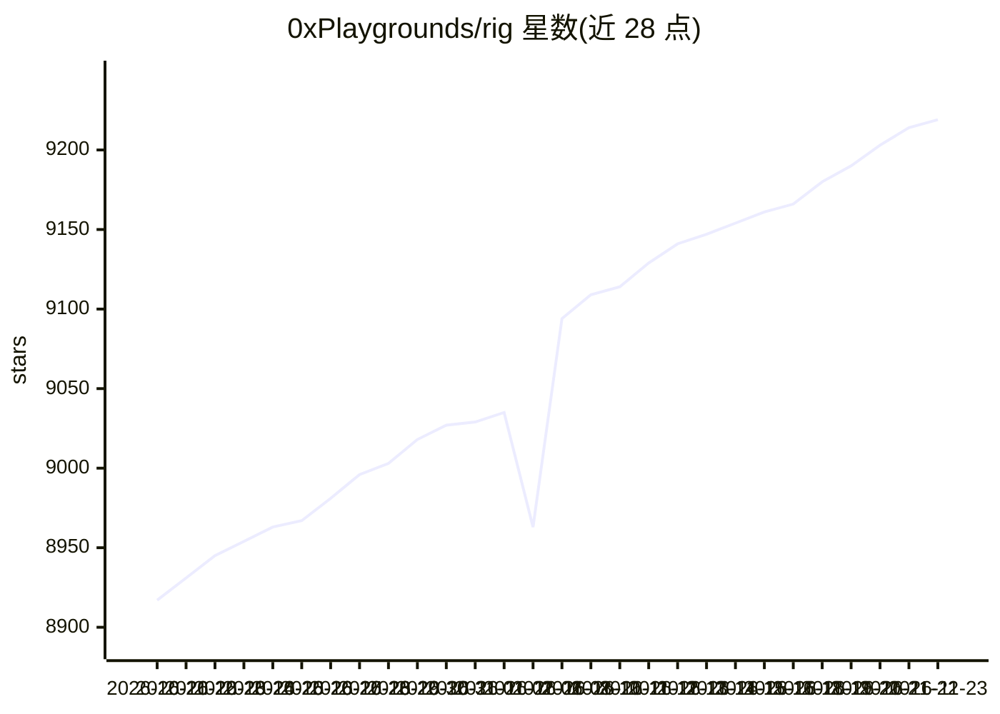

# 0xPlaygrounds/rig

⭐ 9,219 · Rust · MIT · 推送 2026-11-22 · [GitHub](https://github.com/0xPlaygrounds/rig) · [官网](https://rig.rs) · 组织维护

**Rust 开发者的 LLM 应用构建库与终端编码 agent**

Rig 是一个用于构建大语言模型应用的 Rust 库，将 20 多个模型提供方和十余种向量存储统一到同一接口，覆盖 completion、embedding、转录、音频与图像模型，提供带工具、流式输出与类型化 hooks 的 agents，并遵循 OpenTelemetry GenAI 约定；rig-core 与 rig-agent 支持 WASM 构建。库之上附带同名的终端编码 agent `rig`，其工具、命令、会话、登录与终端视图均为 Bevy 插件，可关闭、替换或扩展。需要 Rust 1.97.1 及以上，运行于 Linux 和 macOS。

## 筛选速览

| 维度 | 判定 | 备注 |
|---|---|---|
| AI 角色 | `ai-ecosystem` | LLM/agent 周边工具 |
| 许可风险 | `permissive` | MIT |
| 部署形态 | `library` | 以包/库形式分发 |
| 模型依赖 | locked-api |  |
| 硬件要求 | — | 无带数字的原话,不猜 |
| 安装摩擦 | `low` | 无编译、无系统依赖或容器化 |
| 成熟度 | — | 结构信号不足 |

## 能力要点

- 20+ 模型提供方与十余种向量存储的统一接口
- agents 支持工具调用、流式输出与类型化 hooks
- 终端编码 agent 全插件化（工具/命令/会话均可替换）
- 覆盖 completion、embedding、转录、音频与图像模型，支持浏览器 WASM 构建

## 适用场景

- 用 Rust 构建 LLM 应用并按 feature 选择模型提供方与向量存储
- 在终端使用可插件扩展的编码 agent 辅助改代码
- 通过 MCP 工具与本地模型（candle/fastembed）接入自有推理流程

## 场景标签

`Agent 框架` `编码 Agent` `模型网关` · 领域:Agent 开发

## 证据(README 行号)

> L8: Rig is a Rust library for building applications on large language models.
> L54: Rig puts over 20 model providers and a dozen vector stores behind one
> L31: Its tools, commands, sessions, sign-in and terminal view are each a plugin,

## 星数曲线

2026-10-21 8,917 → 2026-11-23 9,219（+302）

---
*卡片 v1 · prompt 1.4 · 生成 2026-11-22 · 置信度 high · 依据 README sha `e78fa9d29676` · [字段定义](../../DATASET.md)*
