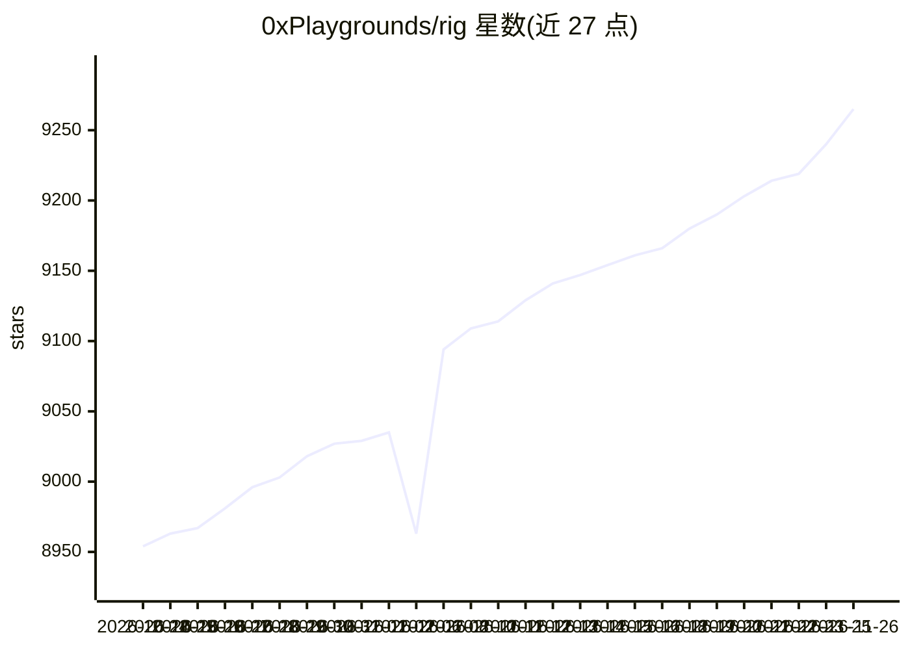

# 0xPlaygrounds/rig

⭐ 9,265 · Rust · MIT · 推送 2026-11-25 · [GitHub](https://github.com/0xPlaygrounds/rig) · [官网](https://rig.rs) · 组织维护

**Rust 库与终端编码 agent：模块化构建 LLM 应用**

Rig 是一个用于在大型语言模型之上构建应用的 Rust 库，将 20 多个模型提供商和多个向量存储统一在同一接口之后，提供带工具、流式输出与类型化钩子的 agent，覆盖补全、嵌入、转录、音频与图像模型，并遵循 OpenTelemetry GenAI 约定。同仓库附带基于该库的终端编码 agent `rig`，其工具、命令、会话、登录与终端视图均为插件，可关闭、替换或扩展；lib 的 rig-core 与 rig-agent 支持 WASM 构建。运行需 Rust 1.97.1+，支持 Linux 与 macOS。

## 筛选速览

| 维度 | 判定 | 备注 |
|---|---|---|
| AI 角色 | `ai-ecosystem` | LLM/agent 周边工具 |
| 许可风险 | `permissive` | MIT |
| 部署形态 | `library` | 以包/库形式分发 |
| 模型依赖 | locked-api |  |
| 硬件要求 | — | 无带数字的原话,不猜 |
| 安装摩擦 | `low` | 无编译、无系统依赖或容器化 |
| 成熟度 | — | 结构信号不足 |

## 能力要点

- 统一接口接入 20+ 模型提供商与多类向量存储
- agent 支持工具调用、流式输出与类型化钩子
- 终端编码 agent 各组件均为 Bevy 插件，可替换扩展
- rig-core/rig-agent 可构建浏览器 WASM 目标

## 适用场景

- 用 Rust 构建 modular 的 LLM 应用与 agent
- 在终端以编码 agent 修改代码库（如修复失败测试）
- 按需组合 memory、本地嵌入、MCP 工具等 feature crate

## 场景标签

`Agent 框架` `编码 Agent` `模型网关` · 领域:Agent 开发

## 证据(README 行号)

> L8: Rig is a Rust library for building applications on large language models.
> L54: Rig puts over 20 model providers and a dozen vector stores behind one
> L9: It also ships `rig`, a terminal coding agent built on the library that you

## 星数曲线

2026-10-24 8,954 → 2026-11-26 9,265（+311）

---
*卡片 v1 · prompt 1.4 · 生成 2026-11-26 · 置信度 high · 依据 README sha `a25b7c8a9e9d` · [字段定义](../../DATASET.md)*
