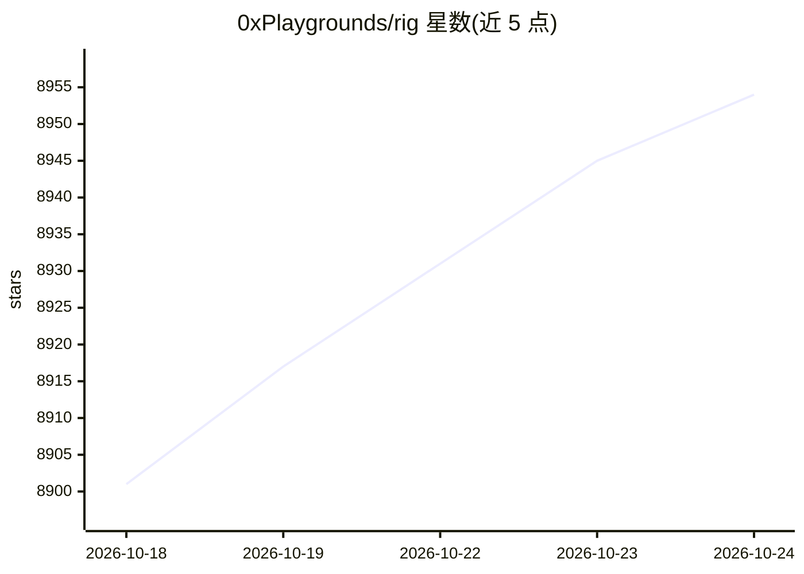

# 0xPlaygrounds/rig

⭐ 8,963 · Rust · MIT · 推送 2026-10-24 · [GitHub](https://github.com/0xPlaygrounds/rig) · [官网](https://rig.rs) · 组织维护

**Rust 的 LLM 应用构建库，附带一个可插件扩展的终端编码 agent**

Rig 提供两层：一是 Rust 库 rig-core 等 crate，将 20+ 模型提供商与 10+ 向量存储统一到一套接口下，支持带工具的 agent、多轮流式、补全/嵌入/转录/图像生成、OpenTelemetry GenAI 语义约定、效果录制回放（rig-cassette）与 WASM 目标支持。二是基于该库构建的终端编码 agent rig，采用 Bevy ECS 插件架构，所有工具/命令/会话均为可增删替换的插件，`/reload` 可在会话内重编译自身。需要 Rust 1.97.1+，agent 运行于 Linux 与 macOS。

## 筛选速览

| 维度 | 判定 | 备注 |
|---|---|---|
| AI 角色 | `ai-ecosystem` | LLM/agent 周边工具 |
| 许可风险 | `permissive` | MIT |
| 部署形态 | `library` | 以包/库形式分发 |
| 模型依赖 | locked-api |  |
| 硬件要求 | — | 无带数字的原话,不猜 |
| 安装摩擦 | `low` | 无编译、无系统依赖或容器化 |
| 成熟度 | — | 结构信号不足 |

## 能力要点

- 20+ 模型提供商与 10+ 向量存储统一接口
- Bevy ECS 插件化终端编码 agent，`/reload` 会话内自重建
- agent 效果的录制与回放（rig-cassette）
- 核心与 agent 运行时支持 wasm32-unknown-unknown 目标

## 适用场景

- 在 Rust 项目中接入多家 LLM 提供商构建 agent 应用
- 用一个可插件定制的终端编码 agent 处理代码任务
- 通过 `rig -p --json` 以管道方式脚本化驱动 agent

## 场景标签

`Agent 框架` `编码 Agent` · 领域:Agent 开发

## 证据(README 行号)

> L27: Rig is a Rust library for building LLM applications, and `rig`, a terminal
> L75: - 20+ model providers and 10+ vector stores, each under one interface

## 星数曲线

2026-10-18 8,901 → 2026-10-24 8,954（+53）

---
*卡片 v1 · prompt 1.4 · 生成 2026-10-20 · 置信度 high · 依据 README sha `2cdb4066df55` · [字段定义](../../DATASET.md)*
