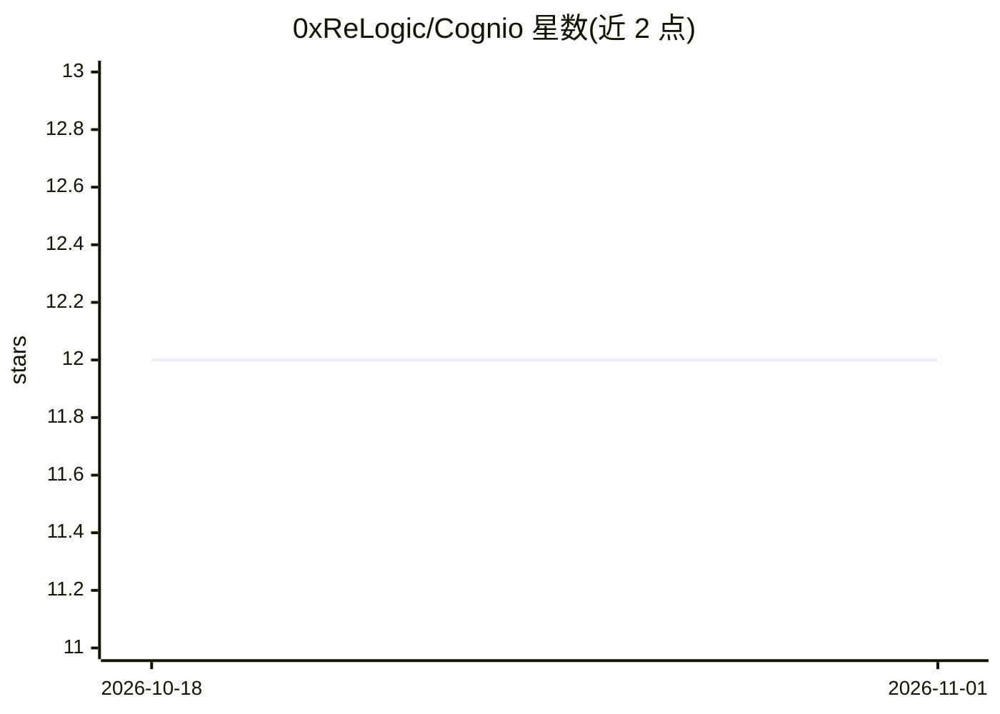

# 0xReLogic/Cognio

⭐ 12 · Python · MIT · 推送 2026-01-18 · [GitHub](https://github.com/0xReLogic/Cognio) · [官网](https://github.com/0xReLogic/Cognio/blob/main/QUICKSTART.md) · 个人维护

**为 AI 助手提供持久语义记忆的 MCP 服务器**

基于 Model Context Protocol 的持久语义记忆服务器：将对话上下文永久存入 SQLite，用 sentence-transformers（paraphrase-multilingual-mpnet-base-v2）做语义检索，支持 100+ 语言、按项目隔离与标签组织、可选 LLM 自动打标与文本摘要。提供 11 个 MCP 工具、REST API 与 Web 管理界面，首启自动为 Claude Desktop、VS Code、Cursor 等 9 个客户端生成 MCP 配置。以 Docker（docker-compose）或源码（poetry）方式部署，需 Python 3.11+，MCP 层为 Node.js。

## 筛选速览

| 维度 | 判定 | 备注 |
|---|---|---|
| AI 角色 | `ai-ecosystem` | LLM/agent 周边工具 |
| 许可风险 | `permissive` | MIT |
| 部署形态 | `self-host` | docker 或自建部署 |
| 模型依赖 | — | README 未给出锁定关系 |
| 硬件要求 | — | 无带数字的原话,不猜 |
| 安装摩擦 | `low` | 无编译、无系统依赖或容器化 |
| 成熟度 | — | 结构信号不足 |

## 能力要点

- SQLite 持久存储 + sentence-transformers 语义搜索（768 维）
- 11 个 MCP 工具，含活动项目上下文自动应用与项目隔离
- 首启自动配置 9 个 AI 客户端（Claude Desktop/Cursor/VS Code 等）
- 提供 REST API、OpenAPI 文档与 Web 记忆管理面板

## 适用场景

- 让 AI 助手跨会话记住个人知识与对话内容
- 多项目工作中隔离并检索各项目的上下文记忆
- 作为研究笔记与学习日志的语义检索存储

## 场景标签

`Agent 记忆` · 领域:Agent 开发

## 证据(README 行号)

> L10: Cognio is a Model Context Protocol (MCP) server that provides persistent semantic memory for AI assistants. Unlike 
> L27: - **MCP Integration**: One-click setup for VS Code, Claude, Cursor, and more

## 星数曲线

2026-10-18 12 → 2026-11-01 12（+0）

---
*卡片 v1 · prompt 1.4 · 生成 2026-11-01 · 置信度 high · 依据 README sha `8e42c7383590` · [字段定义](../../DATASET.md)*
