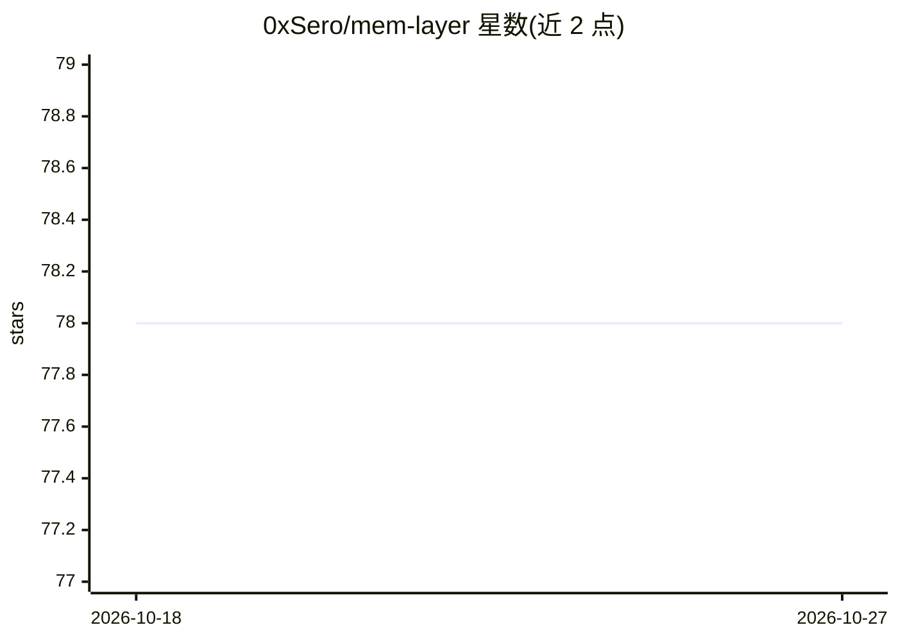

# 0xSero/mem-layer

⭐ 78 · Python · MIT · 推送 2025-12-02 · [GitHub](https://github.com/0xSero/mem-layer) · 个人维护

**面向 AI 模型的图数据库持久记忆管理系统**

Mem-Layer 为 AI 模型提供基于图数据库（NetworkX 引擎 + SQLite 持久化）的持久结构化记忆：支持用户/项目/代码/个人四种作用域隔离、时间感知的知识追踪、模型间异步留言通信、基于 YAML 规则的访问控制。提供 Python API、CLI、MCP Server 等多种接口，MCP Server 可接入 Claude Desktop 等 MCP 客户端。开发状态为 Phase 1 MVP：图引擎与基础作用域已完成，CLI 核心命令、查询引擎、TUI/Web UI 等仍在路线图未勾选项中。

## 筛选速览

| 维度 | 判定 | 备注 |
|---|---|---|
| AI 角色 | `ai-ecosystem` | LLM/agent 周边工具 |
| 许可风险 | `permissive` | MIT |
| 部署形态 | `None` |  |
| 模型依赖 | locked-api |  |
| 硬件要求 | — | 无带数字的原话,不猜 |
| 安装摩擦 | `low` | 无编译、无系统依赖或容器化 |
| 成熟度 | `idea` | |

## 能力要点

- 图数据库记忆管理（NetworkX 引擎 + SQLite 持久化）
- 四种作用域隔离与时间感知的知识变化追踪
- 模型间消息通信与规则式访问控制
- 内置 MCP Server，可接入 Claude Desktop 等 MCP 客户端

## 适用场景

- 让 AI 助手跨会话保留项目上下文与架构决策
- 多个 AI agent 在同一项目下共享记忆与协作
- 为个人学习与研究构建知识图谱

## 场景标签

`Agent 记忆` `知识图谱` · 领域:Agent 开发

## 证据(README 行号)

> L3: > A graph-based memory management system for AI models with scoped persistence, temporal awareness, and cross-model 
> L17: - 🖥️ **Multiple Interfaces**: CLI, Terminal UI, Web UI, and MCP Server
> L40: ### MCP Server (For Claude Desktop & AI Assistants)

## 星数曲线

2026-10-18 78 → 2026-10-27 78（+0）

---
*卡片 v1 · prompt 1.4 · 生成 2026-10-24 · 置信度 high · 依据 README sha `e61d4e72e307` · [字段定义](../../DATASET.md)*
