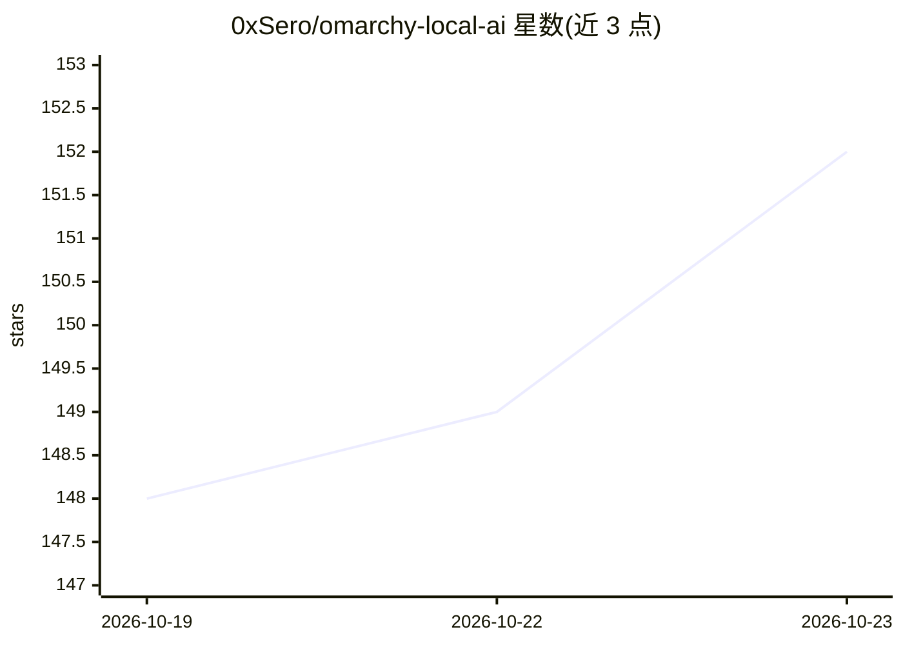

# 0xSero/omarchy-local-ai

⭐ 152 · Shell · MIT · 推送 2026-10-22 · [GitHub](https://github.com/0xSero/omarchy-local-ai) · [官网](https://local.sybilsolutions.ai) · 个人维护

**Omarchy 桌面的本地模型运行面板：按显卡选模型并服务编码 agent**

Omarchy（Quattro shell）插件，以面板加栏按钮的形式在本机 GPU/CPU 上运行本地模型：从按硬件验证过的 recipes.json 目录中挑选适配当前显卡（NVIDIA/Intel Arc Pro/AMD）或 AVX2 CPU 的模型，从 Hugging Face 固定 revision 下载权重并逐文件校验哈希，在 Docker 内隔离网络中启动引擎，经带密钥的 OpenAI/Anthropic/Responses 兼容网关对外服务；用户可一键在指定文件夹打开 Claude Code、Codex、Copilot 等 9 种编码 agent 指向该网关，并可用 tailscale serve 在 tailnet 共享模型。限制：仅限 Omarchy 环境，需 Docker 28+ 等依赖。

## 筛选速览

| 维度 | 判定 | 备注 |
|---|---|---|
| AI 角色 | `ai-ecosystem` | LLM/agent 周边工具 |
| 许可风险 | `permissive` | MIT |
| 部署形态 | `library` | 以包/库形式分发 |
| 模型依赖 | local-ok | 支持本地模型 |
| 硬件要求 | — | 无带数字的原话,不猜 |
| 安装摩擦 | `low` | 无编译、无系统依赖或容器化 |
| 成熟度 | — | 结构信号不足 |

## 能力要点

- 按显卡逐卡验证的模型目录（recipes.json），含正确性与多上下文长度测速
- 权重从 Hugging Face 固定 revision 下载并做 SHA-256/Git blob SHA-1 逐文件校验
- 引擎运行于主机不可达的隔离 Docker 网络，带密钥网关兼容 OpenAI/Anthropic/Responses API
- 一键打开 9 种编码 agent（不改其配置）并用 tailscale serve 共享运行中模型

## 适用场景

- 在我的 Omarchy 机器上按显卡挑选并运行已验证的本地模型
- 让 Claude Code / Codex 等编码 agent 直接用本地模型工作
- 把运行中的模型通过 tailnet 共享给其他设备

## 场景标签

`推理引擎` · 领域:训练与推理

## 证据(README 行号)

> L3: Run a local model on your own GPU or CPU and open a coding agent on it. Local AI picks a model that was tested on yo
> L52: - **Containers.** The engine runs on its own internal Docker network that the host has no address on, shared only w

## 星数曲线

2026-10-19 148 → 2026-10-23 152（+4）

---
*卡片 v1 · prompt 1.4 · 生成 2026-10-22 · 置信度 mid · 依据 README sha `50a54723a919` · [字段定义](../../DATASET.md)*
