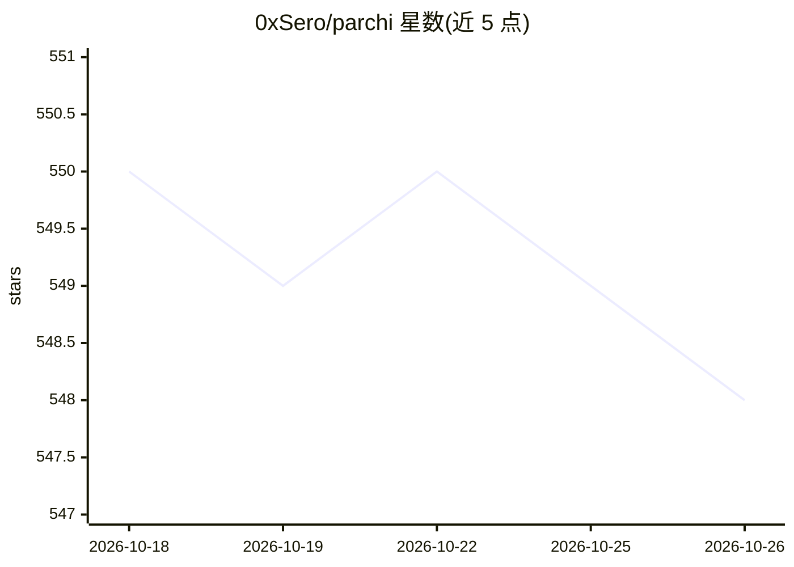

# 0xSero/parchi

⭐ 548 · TypeScript · MIT · 推送 2026-09-17 · [GitHub](https://github.com/0xSero/parchi) · [官网](https://parchi.ai) · 个人维护

**浏览器侧边栏 AI 助手扩展：对话驱动网页自动化**

Chrome/Firefox 浏览器扩展（Chrome MV3），在侧边栏提供聊天式浏览器自动化：导航、读取、点击、输入、提取与摘要。用户可配置任意 OpenAI 兼容的模型提供方（OpenAI、Anthropic 兼容端点、OpenRouter、Ollama/LM Studio 本地端点等），支持流式聊天与工具执行时间线、基于 profile 的模型配置、orchestrator+subagent 流程、会话历史导出及工具权限与域名白名单控制。源码构建安装，附安全提示（prompt 注入、违反站点条款等风险）。

## 筛选速览

| 维度 | 判定 | 备注 |
|---|---|---|
| AI 角色 | `ai-native` | 本体是模型或模型工具 |
| 许可风险 | `permissive` | MIT |
| 部署形态 | `library` | 以包/库形式分发 |
| 模型依赖 | local-ok | 支持本地模型 |
| 硬件要求 | — | 无带数字的原话,不猜 |
| 安装摩擦 | `low` | 无编译、无系统依赖或容器化 |
| 成熟度 | — | 结构信号不足 |

## 能力要点

- 对话驱动的浏览器工具：导航、读取、交互、标签页、截图
- 任意 OpenAI 兼容提供方可配置（含 Ollama/LM Studio 本地端点）
- orchestrator + subagent 流程与流式工具执行时间线
- 工具权限与域名白名单控制

## 适用场景

- 通过自然语言让 AI 代为操作网页（点击、填表、提取内容）
- 配置本地 Ollama/LM Studio 模型在浏览器中使用
- 导出会话历史或限制 AI 仅在指定域名执行操作

## 场景标签

`浏览器自动化` `AI 助手` · 领域:效率与自动化

## 证据(README 行号)

> L5: **AI-powered browser copilot (Chrome/Firefox extension).**
> L7: Chat-driven browser automation in a side panel: navigate, read, click, type, extract, and summarize.

## 星数曲线

2026-10-18 550 → 2026-10-26 548（-2）

---
*卡片 v1 · prompt 1.4 · 生成 2026-10-21 · 置信度 high · 依据 README sha `7a87d8e4dc05` · [字段定义](../../DATASET.md)*
