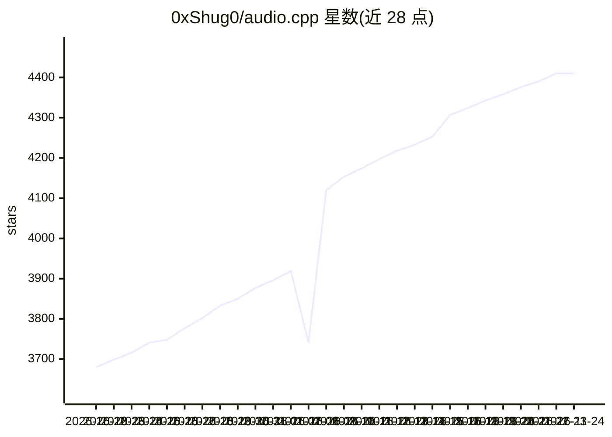

# 0xShug0/audio.cpp

⭐ 4,410 · C++ · NOASSERTION · 推送 2026-11-22 · [GitHub](https://github.com/0xShug0/audio.cpp) · 个人维护

**纯 C++ 本地音频模型推理引擎：TTS/ASR/音乐生成等**

基于 ggml 的 C++ 音频推理框架，为本地音频模型提供统一的原生运行时：支持 TTS、ASR、语音克隆、变声、声源分离、音乐生成、VAD、对齐等多类任务，通过共享 CLI 和 server API 运行 154 个模型家族、250+ 变体。内置 WebUI（Studio/Arena/TTS 应用），支持 GGUF 打包、LoRA 适配器、流式推理。覆盖 Windows/Linux/macOS 与 CUDA、HIP/ROCm、Vulkan、Metal、WebGPU、SYCL、CPU 后端，无 Python 依赖。

## 筛选速览

| 维度 | 判定 | 备注 |
|---|---|---|
| AI 角色 | `ai-native` | 本体是模型或模型工具 |
| 许可风险 | `none` | NOASSERTION |
| 部署形态 | `desktop` | 安装包/桌面程序 |
| 模型依赖 | — | README 未给出锁定关系 |
| 硬件要求 | `cpu-ok` | |
| 安装摩擦 | `low` | 无编译、无系统依赖或容器化 |
| 成熟度 | — | 结构信号不足 |

## 能力要点

- 154 个音频模型家族、250+ 变体，统一 CLI 与 server API
- 7 类后端：CPU/CUDA/HIP/Vulkan/Metal/WebGPU/SYCL
- 内置 WebUI：语音生成/克隆、模型对比 Arena、语音库管理
- GGUF 量化打包、LoRA 适配器、流式推理与 C ABI 库

## 适用场景

- 在本地离线运行 TTS 与语音识别，替代多套 Python 环境
- 为应用集成语音合成/克隆与转录能力
- 在浏览器（WASM+WebGPU）中运行音频推理
- ARM/Rockchip 等边缘设备上部署音频模型

## 场景标签

`语音合成` `语音识别` `推理引擎` `模型量化` · 领域:内容生成

## 证据(README 行号)

> L5: `audio.cpp` is a high-performance C++ audio inference framework built on top of `ggml`, designed to make modern loca
> L32: ⭐ **154 audio model families and 250+ variants.** Run TTS, ASR, music generation, voice cloning, conversion, separa
> L38: ⭐ **Portability.** A native `ggml` runtime supporting CUDA, HIP/ROCm, Vulkan, Metal, WebGPU, SYCL, and CPU through 

## 星数曲线

2026-10-22 3,680 → 2026-11-24 4,410（+730）

---
*卡片 v1 · prompt 1.4 · 生成 2026-11-22 · 置信度 high · 依据 README sha `9d84ca2874bb` · [字段定义](../../DATASET.md)*
