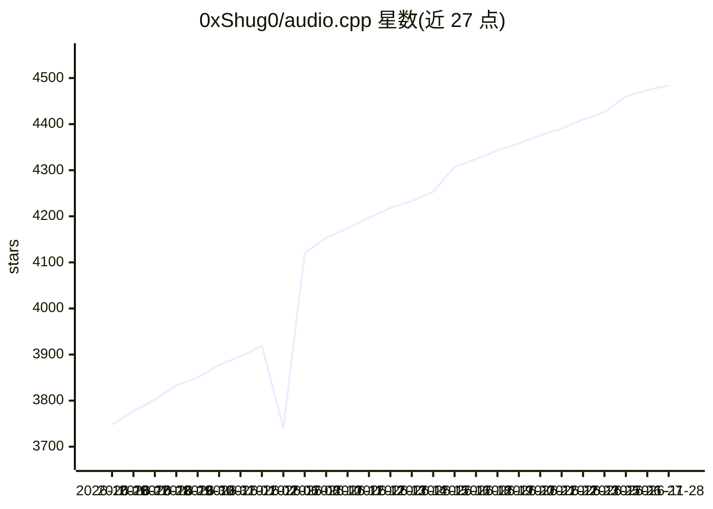

# 0xShug0/audio.cpp

⭐ 4,484 · C++ · NOASSERTION · 推送 2026-11-27 · [GitHub](https://github.com/0xShug0/audio.cpp) · 个人维护

**纯 C++ 音频模型推理引擎：本地运行 TTS/ASR 等**

基于 ggml 的纯 C++ 音频推理框架，免 Python 依赖，通过共享 CLI 与 server API 本地运行 154 个模型家族、250+ 变体，覆盖 TTS、语音克隆、ASR、音乐生成、语音转换、分离、对齐等任务。支持 CUDA、HIP/ROCm、Vulkan、Metal、WebGPU、SYCL 与 CPU 后端，含内置 WebUI（Studio/Arena）、GGUF 打包、LoRA 加载与流式推理。面向需要在本地跨平台运行音频模型的开发者。模型权重许可独立于本项目许可，逐家族在 docs 中列出。

## 筛选速览

| 维度 | 判定 | 备注 |
|---|---|---|
| AI 角色 | `ai-native` | 本体是模型或模型工具 |
| 许可风险 | `none` | NOASSERTION |
| 部署形态 | `desktop` | 安装包/桌面程序 |
| 模型依赖 | — | README 未给出锁定关系 |
| 硬件要求 | `cpu-ok` | |
| 安装摩擦 | `low` | 无编译、无系统依赖或容器化 |
| 成熟度 | — | 结构信号不足 |

## 能力要点

- 154 个音频模型家族、250+ 变体，统一 CLI 与 server API
- 多后端：CUDA/HIP/Vulkan/Metal/WebGPU/SYCL/CPU，含 ARM NEON 与 Rockchip RKNN 优化
- 内置 WebUI：语音生成克隆、模型对比 Arena、语音库与旁白编辑
- GGUF 打包、LoRA 适配器与流式推理支持

## 适用场景

- 在无 Python 环境的机器上本地运行 TTS 与语音识别
- 为应用集成语音克隆、配音或音频分离能力
- 在 Apple Silicon 或 AMD GPU 上做本地音频推理
- 浏览器端 WebGPU/WASM 音频推理部署

## 场景标签

`语音合成` `语音识别` `推理引擎` · 领域:内容生成

## 证据(README 行号)

> L5: `audio.cpp` is a high-performance C++ audio inference framework built on top of `ggml`, designed to make modern loca
> L32: ⭐ **154 audio model families and 250+ variants.** Run TTS, ASR, music generation, voice cloning, conversion, separa
> L38: ⭐ **Portability.** A native `ggml` runtime supporting CUDA, HIP/ROCm, Vulkan, Metal, WebGPU, SYCL, and CPU through 

## 星数曲线

2026-10-26 3,748 → 2026-11-28 4,484（+736）

---
*卡片 v1 · prompt 1.4 · 生成 2026-11-27 · 置信度 high · 依据 README sha `8f997249821b` · [字段定义](../../DATASET.md)*
