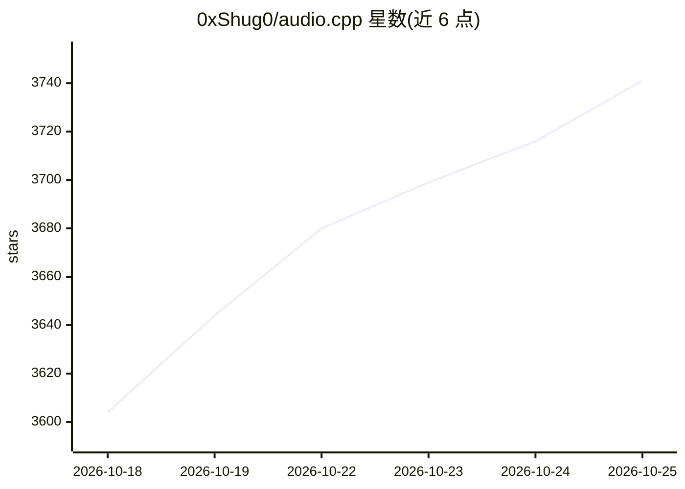

# 0xShug0/audio.cpp

⭐ 3,741 · C++ · NOASSERTION · 推送 2026-10-24 · [GitHub](https://github.com/0xShug0/audio.cpp) · 个人维护

**纯 C++ 音频模型推理引擎：本地运行 TTS/ASR/音乐生成等 110+ 模型**

基于 ggml 的 C++ 音频推理框架，无 Python 依赖，在 Windows/Linux/macOS 上本地运行 110+ 音频模型家族（TTS、语音克隆、ASR、VAD、说话人分离、源分离、音乐生成、语音转换等），通过共享 CLI、server API 和 WebUI 访问。后端覆盖 CUDA、HIP/ROCm、Vulkan、Metal 与 CPU。面向希望在本地部署音频模型的开发者和研究者，支持 GGUF 量化包、流式路径、Arena 对比 UI 与实验性 JSON pipeline。各模型权重沿用各自原许可。

## 筛选速览

| 维度 | 判定 | 备注 |
|---|---|---|
| AI 角色 | `ai-ecosystem` | LLM/agent 周边工具 |
| 许可风险 | `none` | NOASSERTION |
| 部署形态 | `desktop` | 安装包/桌面程序 |
| 模型依赖 | — | README 未给出锁定关系 |
| 硬件要求 | — | 无带数字的原话,不猜 |
| 安装摩擦 | `low` | 无编译、无系统依赖或容器化 |
| 成熟度 | — | 结构信号不足 |

## 能力要点

- 110+ 模型家族、190+ 变体经统一 CLI/server/WebUI 运行
- CUDA/HIP-ROCm/Vulkan/Metal/CPU 多后端，无 Python 依赖
- GGUF 量化包、流式 TTS、Arena 模型对比 UI
- 内置降噪、增强、重采样与 STFT/ISTFT 音频工具

## 适用场景

- 本地运行 TTS/ASR/音乐生成模型，避免 Python 环境管理
- 在服务器上以 API 形式部署语音生成与识别
- 在树莓派、Apple Silicon 等边缘设备上运行音频模型

## 场景标签

`推理引擎` · 领域:训练与推理

## 证据(README 行号)

> L5: `audio.cpp` is a high-performance C++ audio inference framework built on top of `ggml`, designed to make modern loca
> L41: It is built for real end-to-end execution rather than one-off model demos: the same runtime powers TTS, voice cloni
> L47: - **Portability.** A portable native stack centered on `ggml`, with CUDA, HIP/ROCm, Vulkan, Metal, and CPU backends

## 星数曲线

2026-10-18 3,604 → 2026-10-25 3,741（+137）

---
*卡片 v1 · prompt 1.4 · 生成 2026-10-20 · 置信度 mid · 依据 README sha `9614418a8b58` · [字段定义](../../DATASET.md)*
