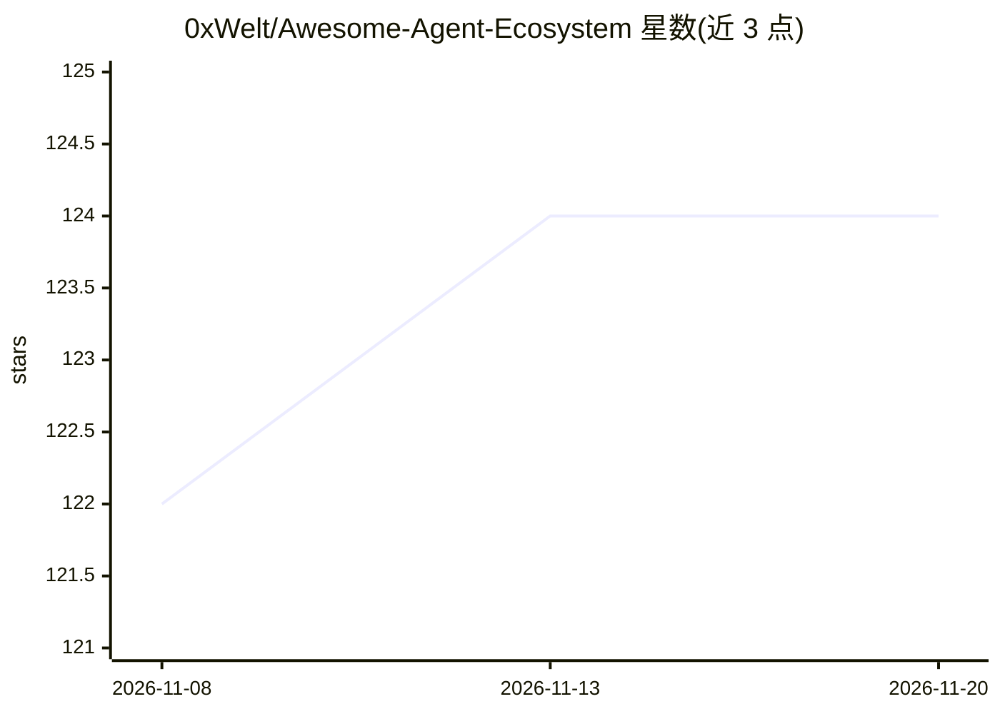

# 0xWelt/Awesome-Agent-Ecosystem

⭐ 124 · 推送 2026-11-18 · [GitHub](https://github.com/0xWelt/Awesome-Agent-Ecosystem) · [官网](https://0xwelt.github.io/Awesome-Agent-Ecosystem/) · 个人维护

**AI agent 生态策展清单：终端产品、agent 服务、模型与开放标准**

一个 awesome-list 形式的编目仓库：用 contents/ 目录下每条目一个 markdown 文件的结构，收录 agent 生态的三大超类——终端产品（通用聊天、编码 agent、vibe coding 社区、个人 agent、AI 增强应用）、agent 服务（24 个垂直类别如基础设施、支付、排程）以及按训练公司分组的 LLM，另含开放标准的 Standards 类。采用分类范围限定的标签体系（交互界面、执行位置、连接方式如 mcp/skill/cli），并由 yaal/scripts/parse-readme.js 从这些文件生成静态网站。许可为 CC BY 4.0。

## 筛选速览

| 维度 | 判定 | 备注 |
|---|---|---|
| AI 角色 | `ai-knowledge` | 知识聚合/清单类 |
| 许可风险 | `none` | — |
| 部署形态 | `None` |  |
| 模型依赖 | — | README 未给出锁定关系 |
| 硬件要求 | — | 无带数字的原话,不猜 |
| 安装摩擦 | `low` | 无编译、无系统依赖或容器化 |
| 成熟度 | — | 结构信号不足 |

## 能力要点

- 每条目一个 markdown 文件，含 name/link 必填 frontmatter
- 三大超类＋Standards 的分类体系，Agent Services 细分 24 个垂直类别
- 分类范围限定的标签词表（desktop/web/mobile、local/cloud/self-hosted、mcp/skill/grok-bot/cli/chatgpt）
- 由 parse-readme.js 从 contents/ 生成静态网站

## 适用场景

- 查找和比较编码 agent、个人 agent 及 vibe coding 社区产品
- 了解 agent 可调用的服务与连接方式（MCP、skill、CLI）生态
- 按贡献规范向清单添加新产品条目

## 场景标签

`精选清单` · 领域:学习与行业

## 证据(README 行号)

> L9: A curated list of terminal products, the services agents call, the models that drive them, and open standards.
> L22: One list with three super-classes, plus thin Standards. Terminal Products are what a person opens: General Chat, Co

## 星数曲线

2026-11-08 122 → 2026-11-20 124（+2）

---
*卡片 v1 · prompt 1.4 · 生成 2026-11-17 · 置信度 high · 依据 README sha `e72a052dde24` · [字段定义](../../DATASET.md)*
