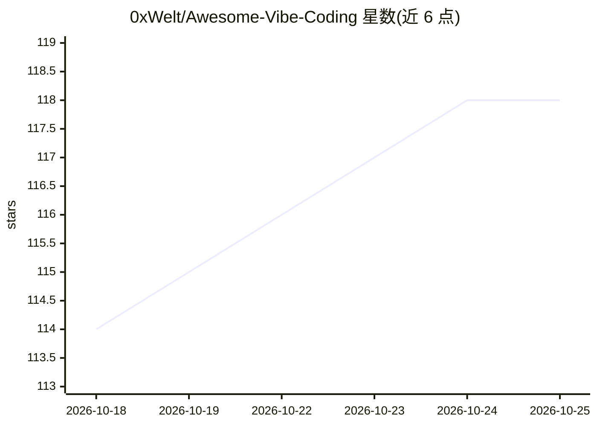

# 0xWelt/Awesome-Vibe-Coding

⭐ 118 · 推送 2026-10-24 · [GitHub](https://github.com/0xWelt/Awesome-Vibe-Coding) · [官网](https://0xwelt.github.io/Awesome-Vibe-Coding/) · 个人维护

**Vibe Coding 开源项目、工具与学习资源策展清单**

由个人维护的 Awesome 类策展清单，收录 vibe coding 生态的工具与学习资源。内容按类别组织在 contents/ 目录（每工具一个 markdown 文件，附 _meta.md 描述），涵盖 Harnesses、社区平台、Platforms、Harness Extensions（MCP 服务器与 agent 技能）、辅助工具、作品与学习资源七大类；由脚本 parse-readme.js 从这些文件生成 GitHub Pages 在线网站。通过添加 markdown 文件并提 PR 收录新工具，许可为 CC BY 4.0。

## 筛选速览

| 维度 | 判定 | 备注 |
|---|---|---|
| AI 角色 | `ai-knowledge` | 知识聚合/清单类 |
| 许可风险 | `none` | — |
| 部署形态 | `None` |  |
| 模型依赖 | — | README 未给出锁定关系 |
| 硬件要求 | — | 无带数字的原话,不猜 |
| 安装摩擦 | `low` | 无编译、无系统依赖或容器化 |
| 成熟度 | — | 结构信号不足 |

## 能力要点

- 七大类组织 vibe coding 工具与资源条目
- contents/ 目录单文件条目 + 自动构建的在线网站
- 通过新增 markdown 文件提 PR 收录工具

## 适用场景

- 查找 vibe coding 相关的 agent 运行器、扩展与辅助工具
- 发现 vibe coding 学习课程与资源
- 为自己的 AI 编码工具寻求收录曝光

## 场景标签

`精选清单` · 领域:学习与行业

## 证据(README 行号)

> L9: A Curated List of Vibe Coding Open-Source Projects, Tools, and Learning Resources
> L33: |Category|Description|Location|

## 星数曲线

2026-10-18 114 → 2026-10-25 118（+4）

---
*卡片 v1 · prompt 1.4 · 生成 2026-10-23 · 置信度 high · 依据 README sha `4b6293e39d99` · [字段定义](../../DATASET.md)*
