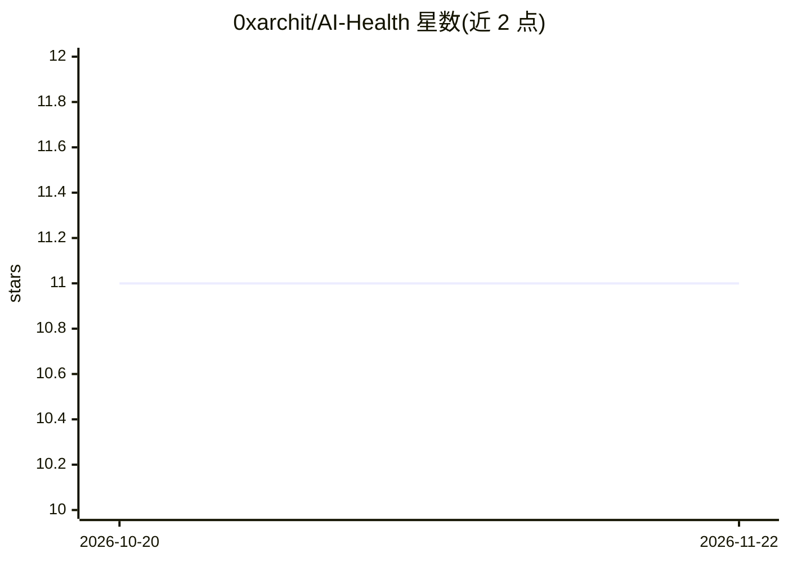

# 0xarchit/AI-Health

⭐ 11 · TypeScript · NOASSERTION · 推送 2026-09-14 · [GitHub](https://github.com/0xarchit/AI-Health) · [官网](https://aihealth.0xarchit.is-a.dev) · 个人维护

**用个人 Gemini 额度分析食物图片营养与健康风险**

基于 Next.js 的 Web 应用，采用 BYOK 模式：用户以 Google 账号 OAuth 登录并授权访问其个人 Gemini API 免费额度，令牌以 AES-256-GCM 加密存于 Postgres。用户上传食物图片后由 Gemini 2.0 Flash 生成热量、宏/微量营养素分解、成分识别与健康评分，结果按原图去重缓存；另提供 3D 人体器官风险映射、上下文感知营养聊天助手、扫描历史、用药追踪与病历存档。使用需自备 Google 账号与 Gemini 额度。

## 筛选速览

| 维度 | 判定 | 备注 |
|---|---|---|
| AI 角色 | `ai-native` | 本体是模型或模型工具 |
| 许可风险 | `none` | NOASSERTION |
| 部署形态 | `None` |  |
| 模型依赖 | — | README 未给出锁定关系 |
| 硬件要求 | — | 无带数字的原话,不猜 |
| 安装摩擦 | `low` | 无编译、无系统依赖或容器化 |
| 成熟度 | — | 结构信号不足 |

## 能力要点

- OAuth BYOK 模式使用用户个人 Gemini 免费额度，无需共享开发者密钥
- 3D 人体模型按成分对心脏、肝脏、肾脏等器官做红/黄/绿风险标注
- 重复图片缓存检测以节省 API 额度
- 健康数据加密存储并启用行级安全策略

## 适用场景

- 拍照分析食物的热量与营养成分
- 按个人过敏史与基础疾病获取个性化饮食建议
- 长期记录饮食、补充剂与病历并查看报告

## 场景标签

`多模态` · 领域:感知与多模态

## 证据(README 行号)

> L10: **AI Health** is a secure web application that empowers users to analyze food images using their own personal AI qu
> L19: 4. **AI Analysis**: When you analyze an image:
> L90: - **AI Model**: Google Gemini 2.0 Flash

## 星数曲线

2026-10-20 11 → 2026-11-22 11（+0）

---
*卡片 v1 · prompt 1.4 · 生成 2026-11-19 · 置信度 high · 依据 README sha `aa1189c99510` · [字段定义](../../DATASET.md)*
