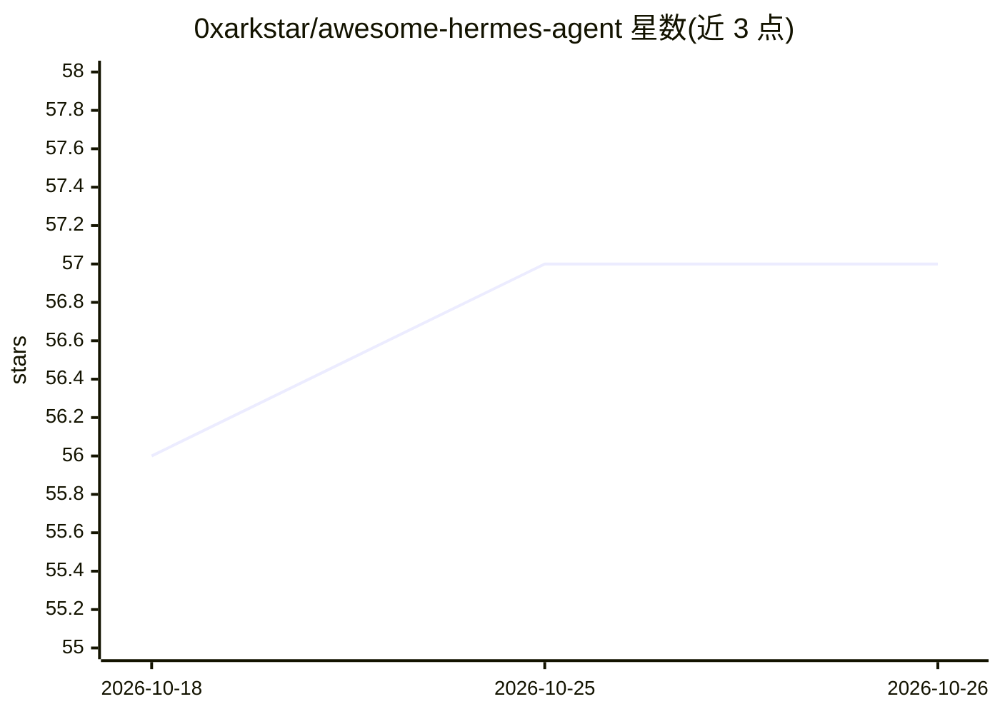

# 0xarkstar/awesome-hermes-agent

⭐ 57 · CC0-1.0 · 推送 2026-03-24 · [GitHub](https://github.com/0xarkstar/awesome-hermes-agent) · 个人维护

**Hermes Agent 周边资源策展清单：模型/部署/技能/教程**

面向 Nous Research 开源 Hermes Agent（自我改进 AI agent）的 awesome 清单，收录官方资源、Hermes 4 系列模型、部署方案（Docker/Nix 等）、技能与插件、工具、集成、记忆与人格配置、训练研究项目、展示项目、教程与社区入口。条目覆盖部署、扩展技能、了解生态的用户需求；清单部分维护工作由 Hermes Agent 自动化完成。

## 筛选速览

| 维度 | 判定 | 备注 |
|---|---|---|
| AI 角色 | `ai-knowledge` | 知识聚合/清单类 |
| 许可风险 | `viral` | CC0-1.0 |
| 部署形态 | `self-host` | docker 或自建部署 |
| 模型依赖 | — | README 未给出锁定关系 |
| 硬件要求 | — | 无带数字的原话,不猜 |
| 安装摩擦 | `low` | 无编译、无系统依赖或容器化 |
| 成熟度 | — | 结构信号不足 |

## 能力要点

- 收录官方资源、Hermes 4 三档模型与技术报告
- 覆盖 Docker/Nix/Portainer 等多种部署方案
- 汇集技能插件、记忆与人格配置指南、训练研究项目

## 适用场景

- 寻找 Hermes Agent 的部署与安装方案
- 为 agent 查找可用的技能与插件
- 了解 Hermes 生态的模型、研究与展示项目

## 场景标签

`精选清单` · 领域:学习与行业

## 证据(README 行号)

> L1: # Awesome Hermes Agent Awesome
> L3: > A curated list of awesome resources for Hermes Agent, the self-improving AI agent by Nous Research.

## 星数曲线

2026-10-18 56 → 2026-10-26 57（+1）

---
*卡片 v1 · prompt 1.4 · 生成 2026-10-24 · 置信度 mid · 依据 README sha `337ff6e5d304` · [字段定义](../../DATASET.md)*
