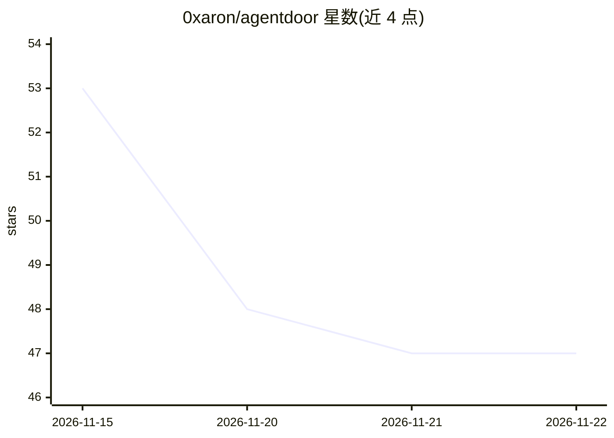

# 0xaron/agentdoor

⭐ 47 · TypeScript · MIT · 推送 2026-03-10 · [GitHub](https://github.com/0xaron/agentdoor) · [官网](https://0xaron.github.io/agentdoor/) · 个人维护

**给 SaaS 提供 AI agent 无头注册认证付费的中间件**

面向 SaaS 开发者的中间件与 SDK 集合：让 AI agent 通过一个 HTTP POST 完成注册、凭证签发与计费设置，宣称全程无浏览器、低于 500ms。核心机制包括 /.well-known/agentdoor.json 发现端点、Ed25519 挑战-响应签名认证、短时 JWT 自动刷新、x402 钱包身份与付费集成。提供 Express/Next.js/Hono/Fastify/FastAPI 等框架适配器，以及 Auth0/Clerk/Firebase 等认证提供商伴生包，与既有人类用户认证并存而非替代。另含 agent 流量检测、控制台与部署模板，要求 Node.js >= 18。

## 筛选速览

| 维度 | 判定 | 备注 |
|---|---|---|
| AI 角色 | `ai-ecosystem` | LLM/agent 周边工具 |
| 许可风险 | `permissive` | MIT |
| 部署形态 | `library` | 以包/库形式分发 |
| 模型依赖 | — | README 未给出锁定关系 |
| 硬件要求 | — | 无带数字的原话,不猜 |
| 安装摩擦 | `low` | 无编译、无系统依赖或容器化 |
| 成熟度 | — | 结构信号不足 |

## 能力要点

- 一次 HTTP POST 完成 agent 注册、凭证签发与计费设置（发现→注册→认证）
- 三种认证模式：Ed25519 挑战-响应（默认）、x402 钱包身份、短时 JWT
- 跨协议自动生成 A2A agent-card 与 OAuth 2.1 发现文件
- 8+ 框架适配器与 6 个认证提供商伴生包，零原生依赖（纯 JS crypto）

## 适用场景

- 让自家 API 产品被 AI agent 无浏览器地注册和调用
- 在保留人类用户 OAuth 登录的同时，为 agent 提供独立认证通道
- 检测并区分到达 API 的流量是人类还是 agent
- 为 agent 调用配置 x402 程序化付费

## 场景标签

 · 领域:AI agent 基础设施/认证与计费

## 证据(README 行号)

> L13: > Make your website agent-ready in 3 lines of code. Let AI agents register, authenticate, and pay for your API — pr
> L50: That's it. Your API is now agent-ready:
> L201: AgentDoor doesn't replace your existing auth provider — it sits alongside it. Human users keep signing in through 

## 星数曲线

2026-11-15 53 → 2026-11-22 47（-6）

---
*卡片 v1 · prompt 1.4 · 生成 2026-11-18 · 置信度 high · 依据 README sha `d447c0ea407f` · [字段定义](../../DATASET.md)*
